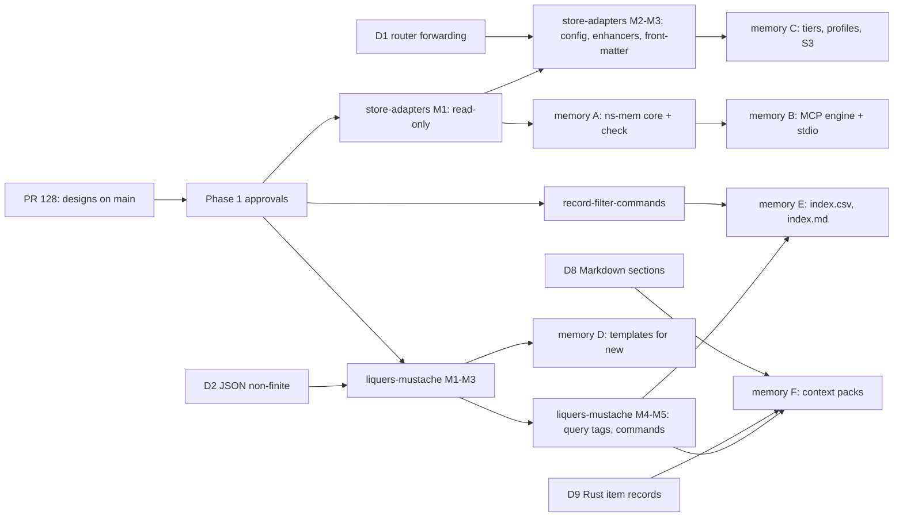

# Execution plan — the work the agent memory service depends on

Companion to [Phase 1](./phase1-high-level-design.md), written 2026-10-13. It orders every issue
and design that `agent-memory-mvp` depends on into tracks and waves, says which acceptance scenario
each one unblocks, and marks what is already done, what is worked around and what is out of scope.
It is a plan for the backlog, not for this design's own Phase 4, which comes after its Phases 2–3.

Statuses are from `specs/index.csv` on 2026-10-13. Designs proceed through the `liquers-project`
gates; nothing below is implemented before its design's Phase 4 is approved.

## 1. Inventory

### 1.1 Already done — no work, but the analyses relied on them being open

| Item | State | What it gives the memory service |
|---|---|---|
| `AXUM-ASSETS-API-ENDPOINTS-NOT-IMPLEMENTED` | closed | `key/listdir`, `key/info`: tiered listing over HTTP |
| `store-and-asset-search` | complete | `ns-search`: R3, R4, `field_extract`, `md_split`, BM25 |
| `axum-query-named-arguments` | complete | Argument overrides: MCP tool arguments without escaping |
| `ARGUMENT-INFO-HAS-NO-DESCRIPTION` | **closed 2026-10-11** | `ArgumentInfo::description`, set by `register_command!`: MCP argument descriptions can come from `CommandMetadata` after all (corrects `interfaces-and-mcp.md` §6) |
| `STORE-VERSION-BLIND-TO-CHANGES-MADE-OUTSIDE-LIQUERS` | **closed 2026-10-02** | A read re-hashes bytes (`VersionVerification::OnRead`, `ExternalChangePolicy`); `verify_stored_versions` walks on demand. `store-adapters` AC-4 extends this to listings |

### 1.2 Required — on the critical path of a Phase 1 acceptance scenario

| # | Item | Kind / state | P · size | Unblocks (agent-memory AC) |
|---|---|---|---|---|
| D1 | `STORE-ROUTER-DOES-NOT-FORWARD-ASSET-INFO` | issue, no design | P2 · S | Folder tiers through the router: AC-1, AC-17; `store-adapters` AC-8 |
| D2 | `VALUE-TO-JSON-PANICS-ON-NON-FINITE-FLOAT` | issue, no design | P2 · S | Values → JSON for MCP results and template data: AC-14, `liquers-mustache` AC-7 |
| D3 | `store-adapters` M1 — read-only adapter (`STORE-NO-READ-ONLY-ADAPTER`) | design, Phase 1 in review | P2 · M | AC-13; decision 2 ("fixed first") |
| D4 | `store-adapters` M2–M3 — adapter configuration, registry, enhancers | same design | part of XL | Front-matter adapter: AC-1, AC-5 (creation), AC-11, AC-17; profiles AC-18, AC-19 |
| D5 | `liquers-mustache` M1–M3 — public parser surface, template parser and diagnostics, renderer with *apply* | design, Phase 1 in review (`NO-QUERY-AWARE-TEMPLATE-LANGUAGE`) | P2 · XL | Templates for `memory_new`: AC-4 |
| D6 | `liquers-mustache` M4–M5 — asset-aware query tags, commands (`SIMPLE-TEMPLATE-HAS-NO-COMMAND`) | same design | | Context packs AC-21, `index.md` AC-22 |
| D7 | `record-filter-commands` — filters and `sort` for records (`RECORD-AND-POLARS-COMMANDS-NOT-INTEROPERABLE`) | design, Phase 1 draft | P2 · L | `index.md` AC-22 (sort, count); `index.csv` AC-10 (ordering) |
| D8 | Markdown section access — the minimum of `NO-MARKDOWN-NAVIGATION-COMMANDS` | feature, no design | P3 · L | Section read AC-3, fallback tiers AC-17, packs AC-21 |
| D9 | Rust item records — the first half of `NO-SOURCE-CODE-AND-API-DOC-NAVIGATION` | feature, no design | P3 · L | Decision 6; code sections of packs AC-21 |

### 1.3 Worked around — not blocking, fix later

| Item | Workaround in the MVP |
|---|---|
| `STORE-WRITE-HAS-NO-PRECONDITION` (P2 M) | AC-6 is check-then-write inside one process; atomic across processes only once fixed |
| `CORE-METADATA-NO-APPLICATION-ATTRIBUTES` (P2 M) | Fields beyond title/description are read as `field_extract` records, not metadata |
| `store-adapters` layouts (`STORE-METADATA-LAYOUT-HARDCODED-PER-STORE`) | Writable mounts keep the sidecar layout; read-only mounts write nothing via D3 |
| `DIRECTORY-KEY-CANNOT-BE-EVALUATED-AS-A-RESOURCE` (P3 M) | Queries use `-R-key/<folder>` (as `SEARCH_GUIDE.md` §7 says) |

### 1.4 Out of scope of the MVP

`CORE-SESSION-AND-KEY-ACL` (identity), `COMMAND-CANNOT-BE-RUN-WITH-A-RESTRICTED-CONTEXT` (needed only
for a general `query` tool over MCP), `external-index-sync` / `ASSET-EXPIRATION-EVENTS-CANNOT-BE-OBSERVED-EXCEPT-PER-ASSET`
(semantic search), `NO-TEMPLATE-EDITOR-UI`, `QUERY-DOCS-CLAIM-LINK-PARAMETERS-DO-NOT-PARSE` (a doc
fix; worth doing in Wave 0 because `liquers-mustache` extends that parser, but not blocking).

## 2. Dependency graph

## 3. Tracks and waves

Three tracks run in parallel; a wave starts when its inputs are approved or merged.

### Wave 0 — now, no design needed (each S, one PR each)

| Step | Item | Why now | Proof |
|---|---|---|---|
| 0.1 | Merge PR 128 | Puts the three designs on `main`, so their issues are reciprocal and visible | `docs_index.py --check` 0 errors on `main` |
| 0.2 | D1 router forwarding | Small, generic, unblocks folder tiers; `store-adapters` assumes it | A conformance test: a member's `get_asset_info` is observed through the router |
| 0.3 | D2 non-finite floats | Small; the template data model and MCP results go through it | Unit test for NaN, +∞, −∞ |
| 0.4 | `QUERY-DOCS-CLAIM-LINK-PARAMETERS-DO-NOT-PARSE` | Corrects the docs of the parser `liquers-mustache` extends | Doc-only |

Candidates for the automatic-fix route (`references/auto-fix.md`): D1, D2 and 0.4 are S, single
module, with an obvious test — label them `eligible` when triaged.

### Wave 1 — the three gates (decisions, no code)

| Step | Gate | Decision it needs |
|---|---|---|
| 1.1 | `store-adapters` Phase 1 → Phase 2 | Wrapper vs pipeline; split layouts from adapters (its open questions 1 and 5) |
| 1.2 | `liquers-mustache` Phase 1 → Phase 2 | Hygienic and raw expansion; public parser surface; nested braces (open questions 1, 8, 9) |
| 1.3 | `agent-memory-mvp` Phase 1 → Phase 2 | Split into designs (decision 12); confirm decision 7 now points at `liquers-mustache` |
| 1.4 | `record-filter-commands` Phase 1 | It is still a draft; the memory service needs only filters, `sort` and a count |

### Wave 2 — foundations (three parallel tracks)

| Track | Steps | Delivers | Unblocks |
|---|---|---|---|
| **Stores** | `store-adapters` Phases 2–4, then **M1** read-only adapter with a forwarding base and a runtime read-only accessor | D3 | AC-13; memory A can mount `specs/` safely |
| **Templates** | `liquers-mustache` Phases 2–4, then **M1** public parser surface in `liquers-core`, **M2** template parser, AST, positioned diagnostics, highlighting, **M3** renderer with the Mustache conformance suite and *apply* | D5 | AC-4 (templates for `new`) |
| **Records** | `record-filter-commands` Phases 2–4 and implementation | D7 | AC-10, AC-22 ordering and counts |

The memory design itself runs its Phases 2–3 during this wave, against the approved interfaces of
the three tracks.

### Wave 3 — memory core, while the tracks finish

| Step | Work | Needs | ACs |
|---|---|---|---|
| 3.1 (memory A) | `ns-mem` core: schema, `describe`, `similar`, `new` (without templates), `write`, `edit`, `set_field`, `append_row`, write log, `check` with the `docs_index.py` oracle | Wave 2 Stores M1 | AC-2, 5, 6, 7, 8, 9, 12, 13, 15, 16 |
| 3.2 (memory B) | `liquers-mcp` engine (tools as declared queries, schemas from `CommandMetadata` including argument descriptions) and `liquers-mem mcp` over stdio | 3.1 | AC-14 |
| 3.3 | `store-adapters` **M2–M3**: adapter configuration and registry, hash-on-change and front-matter enhancers (the front-matter adapter in `liquers-lib`) | D1, M1 | — |
| 3.4 | `liquers-mustache` **M4–M5**: query tags through the asset layer, dependencies, partials; `tpl` commands | D5 | — |
| 3.5 | D8 minimum: `section` by heading path (absorbed into `ns-mem`, or a compact design under `NO-MARKDOWN-NAVIGATION-COMMANDS`) | — | AC-3 |
| 3.6 | D9 Rust item records (`syn`), as its own compact design under `NO-SOURCE-CODE-AND-API-DOC-NAVIGATION` | — | decision 6 |

### Wave 4 — memory features that need two tracks

| Step | Work | Needs | ACs |
|---|---|---|---|
| 4.1 (memory C) | Tiers through the front-matter adapter, fallback tiers, configuration profiles, S3 mount | 3.3 | AC-1, 11, 17, 18, 19, 20 |
| 4.2 (memory D) | Templates in `memory_new` | Wave 2 Templates (M3) | AC-4 |
| 4.3 (memory E) | `index.csv` and `index.md` as recipes over simple commands and a page template | Wave 2 Records, 3.4 | AC-10, AC-22 |
| 4.4 (memory F) | `memory_context` packs | 3.4, 3.5, 3.6 | AC-21 |

### Wave 5 — closing

Phase 5 of each design; the `liquers-memory` skill and `AGENT_MEMORY_SERVICE.md` reference; the
oracle comparisons (AC-9, AC-10, AC-22) green in CI; `docs_index.py` kept as the oracle until a
decision retires it.

## 4. Critical path and risks

**Critical path:** PR 128 → `liquers-mustache` gate → its M1 (a public parser API in `liquers-core`)
→ M2–M5 → memory E and F. The template language is the longest and least certain track; its M1
changes `liquers-core`'s public surface, the step most likely to need iteration.

**Mitigations:**
- **Interim templates.** If the template track lags, memory D and E can use the interim of decision 7
  (an existing Mustache engine, then an `expand` pass) behind the same command names, so templates
  written in the interim survive.
- **Order inside the memory design.** Memory A and B (most acceptance scenarios, and the MCP server
  agents actually use) depend only on the read-only adapter, not on templates or records — they are
  deliberately first.
- **Size.** `agent-memory-mvp` is XL; the split asked for in decision 12 should follow these waves:
  core and MCP (A, B), tiers and profiles (C), templates, indexes and packs (D, E, F).

**Open dependencies to watch:** `STORE-WRITE-HAS-NO-PRECONDITION` becomes blocking the day two
processes write one memory (an MCP server and a CLI at once); `COMMAND-CANNOT-BE-RUN-WITH-A-RESTRICTED-CONTEXT`
becomes blocking the day a general `query` tool is offered over MCP.

## 5. Summary by wave

| Wave | Items | Parallel? |
|---|---|---|
| 0 | PR 128, D1, D2, link-docs fix | Yes, four small PRs |
| 1 | Three Phase 1 gates + `record-filter-commands` Phase 1 | Decisions only |
| 2 | Stores M1 · Templates M1–M3 · Records | Three tracks |
| 3 | Memory A, B · Stores M2–M3 · Templates M4–M5 · sections · Rust items | Mostly parallel |
| 4 | Memory C, D, E, F | After their inputs |
| 5 | Documentation, skill, oracles in CI | — |
