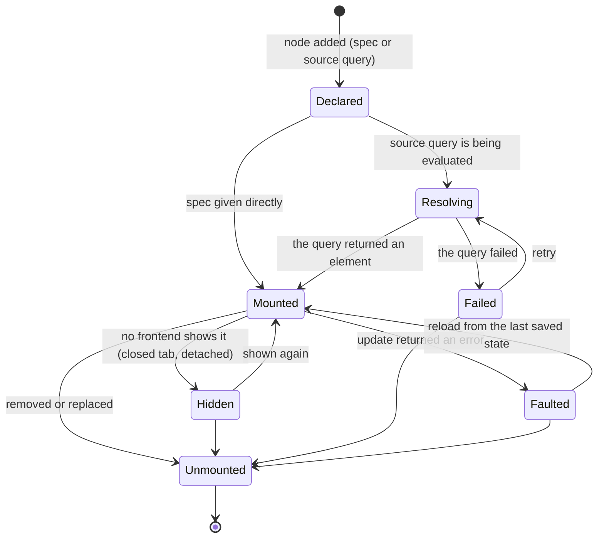

# UI redesign: master design

Written 2026-11-23 at Orest's request. It covers the whole redesign at the level of a Phase 1
(what and why) and a Phase 2 (architecture), so it is longer than the phase limits allow for one
design. Designs D1–D21 of the [plan](./plan.md) rely on it: each of them refines one part and may
not contradict it without changing this document first. The problems it answers are in the
[review of the current architecture](./current-architecture-review.md) (F1–F11).

**Status: proposed, not approved.** One decision here revises an earlier one (§3.4) and needs
Orest's confirmation. Signatures are sketches that fix the shape, not final code.

**Contents.** 1 Requirements · 2 Answer in short · 3 Which abstraction · 4 Concepts ·
5 Elements · 6 Lifecycle · 7 Messages and events · 8 Turns · 9 Effects and subscriptions ·
10 The view tree · 11 Frontends: three patterns over one store · 12 Session and runtime ·
13 Transparency · 14 Elements as data, commands, UISpec · 15 Values and display forms ·
16 Protocol and transport · 17 Sessions and identity · 18 Theme and style · 19 Input, keymap and
controls · 20 Persistence and addresses · 21 Python and JavaScript · 22 Crates and modules ·
23 Threading, wasm and errors · 24 Testing and conformance · 25 Migration · 26 Acceptance
scenarios · 27 Decision register · 28 Open questions · 29 Impact on the plan

---

## 1. Requirements

| # | Requirement | Source |
|---|---|---|
| R1 | The UI model does not depend on `liquers-lib` or on a toolkit | goal G1, F9 |
| R2 | egui, web and ratatui are first-class; a new frontend is a new crate | G2, decisions 1 and 3 |
| R3 | The core holds as much logic as possible; a frontend draws and reports input | decision 1, F2 |
| R4 | One abstraction serves immediate mode, retained mode, the DOM and client-server | Orest 2026-11-23 |
| R5 | Monolithic and split run the same elements; any frontend can be a split client | G3 |
| R6 | The lifecycle and the events are explicit, ordered and observable | Orest 2026-11-23, F4, F5 |
| R7 | The UI never waits for a query; expired values are fetched again | F6 |
| R8 | The web is designed in: one thread, retained DOM, CSS, native text input, several mounts | decision 3, plan §1.1 |
| R9 | Elements can be created by queries, saved, restored and sent | F8, VISION "every view is a query" |
| R10 | Python and JavaScript can define elements | `web-ui-define`, `liquers-py-ui` |
| R11 | Data stays where it lives; a client gets what it can show | `ui-split-elements` |
| R12 | Sessions with pluggable identity; several sessions per environment, several mounts per page | G6, F10 |
| R13 | Theme, icons, keymap, MIDI and high-level controls work the same in every frontend | G7, G13, G14 |
| R14 | The old UI keeps working until M7 | plan §6 |

## 2. Answer in short

**Are there fundamental problems in the old architecture?** Yes, three, and they explain most of
the open issues (review §4): state is not separated from presentation, deciding is not separated
from doing, and the tree has no single owner. They cannot be fixed inside the `UIElement` trait,
because the trait *is* the first problem.

**Which abstraction?** Model-View-Update with a renderer-neutral view tree:

1. An **element** is a state machine. `update(msg, cx)` is the only place its state changes. It
   performs nothing itself: it asks for effects through `cx`, and the runtime performs them.
2. `view()` is a pure function from the element's state to a **view tree**: plain data made of a
   small, closed vocabulary of nodes (column, text, button, table, child slot, …) with stable keys.
3. One **session** owns the tree of elements, runs one message at a time, and publishes the view
   trees and their changes (**patches**) into a **view store**.
4. A **frontend** is an interpreter of the view store. It draws nodes and sends input events back.
   It contains no element-specific code.

The four rendering situations then differ only in how the view store is consumed:

| Situation | How the frontend uses the view store |
|---|---|
| Immediate mode (egui, ratatui) | Walks the current view tree every frame and draws it |
| Retained mode (Slint, GTK) | Applies each patch to the widgets it created earlier |
| DOM (browser) | Applies each patch to DOM nodes; styling is CSS |
| Client-server | The patches cross a transport into a copy of the view store; the client then uses one of the three rows above |

**Is it the obvious choice?** It is the only candidate that satisfies R3, R4 and R5 together
(§3). It is not free: it has real costs (§3.3), and each has a designed answer. The main one is
that the vocabulary limits what an element can show; the escape is the *native widget* node
(§10.6).

## 3. Which abstraction

### 3.1 Candidates

- **A. Model plus one view per frontend, typed messages.** The plan's sketch and
  `ui-split-elements` option C: `ElementModel` with `Down`/`Up` messages, and `EguiView`,
  `WebView`, `TuiView` per element. Jupyter widgets work this way.
- **B. Model-View-Update with a neutral view tree.** Elm, iced, React Native, Flutter's widget
  tree, Xilem, Phoenix LiveView (which sends tree diffs over a WebSocket) and Dioxus (one virtual
  DOM rendered to the web, a webview, a live view and at one time a terminal).
- **C. Reactive signals.** Leptos, Solid: fine-grained signals wired directly to widgets.
- **D. Immediate-mode facade.** One `ui.button("Run")` API in the style of egui, implemented by
  every frontend; element code runs every frame.
- **E. Server-rendered HTML patches.** LiveView or htmx proper: the server sends HTML.
- **F. Abstract retained widgets.** A widget object tree in the style of wxWidgets or Qt, with a
  backend per toolkit.
- **G. Adopt a framework** (Dioxus, iced) instead of building the layer.

### 3.2 Comparison

| | A views per frontend | B MVU + view tree | C signals | D immediate facade | E HTML | F widget objects |
|---|---|---|---|---|---|---|
| Logic in the core (R3) | partly: each view re-implements interaction | yes | yes | yes | yes | partly |
| Immediate mode | natural | walk the tree | awkward: signals want retained widgets | natural | no | awkward |
| Retained and DOM | each view does its own bookkeeping | patches from one diff | natural | needs a diff of the recorded frame, which is B | DOM only | natural |
| Client-server (R5) | client must ship every element's view code | thin client: patches down, events up | signal graph does not cross a wire | every frame would cross the wire | web only | object sync protocol per widget |
| Cost of a new element | one model + N views | one model + one view | one component | one function | one template | one model + widgets |
| Cost of a new frontend | views for every element | one interpreter | one binding layer | one backend | — | one backend |
| Lifecycle visible (R6) | per view, per frontend | one place | implicit in the graph | implicit per frame | server only | per widget |
| Elements from Python/JS (R10) | need a view per frontend | view is JSON-like data | hard | callbacks every frame | templates | hard |
| Test without a toolkit | model only | model and view | needs a runtime | needs a recorder | string compare | no |

- **A** grows as elements × frontends, and that is exactly how the old editor ended up with
  two input paths (F2). A split client needs the view code of every element, so a third-party
  element cannot be shown by a stock client.
- **C** hides the event order inside a dependency graph, the opposite of R6, and has no natural
  form on a wire or in immediate mode.
- **D** is the most pleasant to write, but once the recorded frame has to be diffed for the DOM
  or sent to a client it has become B with a different front door. It is kept as an optional
  authoring style: a builder that produces view nodes.
- **E** serves one frontend. **F** fits neither immediate mode nor the DOM well, and its common
  subset problem is the same as B's without B's benefits.
- **G.** No framework covers egui, a terminal, the DOM and a split mode with Liquers assets,
  queries and commands inside. Dioxus is closest, but its vocabulary is HTML, its state lives in
  hooks rather than in data (R9), and egui is not a target. Its ideas are used; it is not adopted.

### 3.3 The costs of B, and the answers

| Cost | Answer |
|---|---|
| The vocabulary is a common subset; an element cannot draw anything it likes | Native widget nodes with a per-frontend renderer and a required fallback (§10.6); a neutral `Canvas` node; capability levels (§10.7) |
| A view is rebuilt and diffed after each message | Only the element that got the message is rebuilt; bulk data never sits in the tree (tables are pages, charts are windows: §10.5, §15) |
| Short-lived state (hover, caret, scroll position, a half-typed word) does not belong in the model | It stays in the frontend, keyed by the node's stable id, under fixed rules (§10.4) |
| In split mode every interaction costs a round trip | Frontend-owned drafts and scrolling, opt-in events, native widgets with local behaviour, and later elements placed on the client (§16.4) |
| egui authors lose `ui.button()` inside elements | The builder of D; an egui-only native widget for the rare case; old elements run fused (§25) |
| The core must own a diff, a patch format and a store | It is one implementation, tested once, instead of bookkeeping in every retained view |

### 3.4 What this revises

`ui-split-elements` chose typed `Down`/`Up` messages per element (its option C), and the plan §1
drew `ElementModel` plus `EguiView` / `WebView` / `TuiView`. Under this design **the default
element has no per-frontend code and no typed wire messages**: its view tree is what travels.
Typed element messages survive in one place, the native widget (§10.6), whose properties go down
and whose events come up. Everything else that design decided (server authoritative, revisions,
resync, session ≠ connection, capabilities in `hello`) is kept. **This needs Orest's
confirmation** (§28 Q1).

## 4. Concepts

```text
  Environment (store, assets, commands)                         one per process
        │ evaluates queries, delivers asset events
  ┌─────┴──────────────────────────── Session ─────────────────────────────────┐
  │  mailbox ──► turn: route msg ► Element.update(msg, cx) ► effects           │
  │                                   │                                        │
  │  tree of nodes ── each: handle, source query, element (state), lifecycle   │
  │                                   │ view()                                 │
  │                              view trees ──► diff ──► patches               │
  └───────────────────────────────────┬────────────────────────────────────────┘
                                      ▼
                                 View store ◄──── (split: a copy, fed over a transport)
                                      │  frames (revision, patches)      ▲ input events
                 ┌────────────────────┼────────────────────┐             │
            egui frontend        DOM frontend         ratatui frontend ──┘
            (walk per frame)    (apply patches)       (walk per frame)
```

| Term | Meaning |
|---|---|
| **Session** | One running UI: a tree of nodes, their elements, a mailbox. The single owner of all UI state. |
| **Node** | A place in the tree: a handle, an optional source query, a lifecycle state, at most one element. |
| **Handle** | The stable identity of a node within a session (kept from today). |
| **Element** | State plus `update` and `view`. Lives in a node. |
| **Message** | The only input of an element (§7). |
| **Effect** | A request an element makes of the runtime: subscribe, evaluate, add a child, set a timer (§9). |
| **View tree** | What an element looks like now, as data. Made of **view nodes** with **keys**. |
| **Patch** | One change to a view tree. A **frame** is the patches of one turn with a revision number. |
| **View store** | The current view trees of a session and their revision. What a frontend reads. |
| **Frontend** | An interpreter of the view store for one toolkit, plus the host loop (window, terminal, page). |
| **Display form** | A value prepared for showing: text, a table page, an image, a chart (§15). |

Three rules follow from the three root causes:

1. **State is separate from presentation.** Elements never see a toolkit; frontends never see an
   element.
2. **Deciding is separate from doing.** `update` decides and describes; the session does.
3. **One owner.** Only the session touches the tree. Everything else sends it messages.

## 5. Elements

```rust
/// One UI element: its state, how messages change it, and what it looks like.
pub trait Element<E: Environment>: MaybeSend + 'static {
    /// Registered type name, e.g. "asset_view". Used to save and re-create the element.
    fn type_name(&self) -> &'static str;

    /// The only place the state changes. Must not block or await; asks for effects through `cx`.
    fn update(&mut self, msg: Msg<E>, cx: &mut Cx<'_, E>) -> Result<(), Error>;

    /// What the element looks like now. Pure: no effects, no I/O, same state gives same view.
    fn view(&self, vx: &ViewCx<'_>) -> View;

    /// The state to save or send, as data. `ElementFactory::create` is its inverse.
    fn save(&self) -> Result<serde_json::Value, Error>;

    /// Title for tabs, windows and the inspector.
    fn title(&self) -> String { self.type_name().to_string() }
}
```

- `E` is the environment type (Phase 1 question 2, agreed). It appears only on the engine side:
  `Element`, `Msg`, `Cx`, `Session`. `View`, `Patch`, the view store and every frontend are not
  generic, so a split client needs no environment at all.
- `ViewCx` gives read-only context a view may depend on: the node's handle, whether it has focus,
  the frontend's capability level and size class (§10.7), the resolved theme's names. Views that
  depend on it stay pure functions of (state, context).
- An element holds no `Arc<Mutex<…>>` to anything shared, no asset references it polls, and no
  toolkit object.

A complete element, to show the shape:

```rust
pub struct AssetView { query: Query, sub: Option<SubId>, snap: Option<Snapshot> }

impl<E: Environment> Element<E> for AssetView {
    fn type_name(&self) -> &'static str { "asset_view" }

    fn update(&mut self, msg: Msg<E>, cx: &mut Cx<'_, E>) -> Result<(), Error> {
        match msg {
            Msg::Lifecycle(Lifecycle::Mount) => {
                self.sub = Some(cx.subscribe(Subscribe::query(&self.query).display(Want::Best)));
            }
            Msg::Data(_, snapshot) => self.snap = Some(snapshot.display_only()),
            Msg::Input(Input { key, event: InputEvent::Activate }) if key == "reload" => {
                if let Some(sub) = self.sub { cx.refresh(sub); }
            }
            other => cx.pass(other),          // not mine: bubble to the parent
        }
        Ok(())
    }

    fn view(&self, _vx: &ViewCx<'_>) -> View {
        let body = match &self.snap {
            None => View::progress(None),
            Some(s) => View::display(&s.display).status(s.status),
        };
        View::column().child(body).child(View::button("Reload").key("reload"))
    }

    fn save(&self) -> Result<serde_json::Value, Error> { /* {"query": …} */ }
}
```

The real code lists every `Msg` variant instead of `other =>` (CLAUDE.md match rule); a
`cx.pass_unhandled(msg)` helper keeps that short.

## 6. Lifecycle

A node goes through these states. The session moves it; nothing else can.



| State | What the user sees | Element gets |
|---|---|---|
| Declared, Resolving | A placeholder drawn by the session: title, progress, cancel | nothing (no element yet) |
| Failed | The error and a retry button, drawn by the session | nothing |
| Mounted | The element's view | all messages |
| Hidden | nothing | data and replies still; `view` is not called |
| Faulted | The last view with an error banner and a reload button | nothing until reloaded |
| Unmounted | nothing | nothing, ever |

**Guarantees.** They are the contract of R6, and each is a test in D1.

1. `Mount` is the first message an element gets, exactly once. Its saved state has already been
   restored by the factory, so `Mount` is where it subscribes.
2. `Unmount` is the last message. After it the element gets nothing, and the session cancels its
   subscriptions, timers and pending requests. An element never has to clean up to be correct.
3. Parents mount before children; children unmount before parents.
4. `Hide` and `Show` come in pairs between `Mount` and `Unmount`. A subscription made with
   `pause_when_hidden` stops refreshing while hidden and refreshes once on `Show`.
5. Replacing the element of a node is `Unmount` (old), `Mount` (new) on the same handle, and
   increases the node's **generation**. A reply, a data update or an input event addressed to an
   older generation is dropped and traced. This is the "node replaced during an evaluation" case
   that `web-ui-use` found to be normal on wasm.
6. The placeholder, failure and fault views are drawn by the session with ordinary view nodes, so
   they look the same in every frontend and no element implements them.

## 7. Messages and events

One enum is the complete list of what can happen to an element:

```rust
pub enum Msg<E: Environment> {
    Lifecycle(Lifecycle),        // Mount, Show, Hide, Unmount
    Input(Input),                // from one of this element's view nodes: { key, event }
    Control(ControlEvent),       // a high-level function: zoom, pan, rotate, step, select (§19)
    Data(SubId, Snapshot<E>),    // a subscription changed: status, display form, progress, error
    Reply(RequestId, Reply<E>),  // the result of a one-shot effect
    Timer(TimerId),
    Child(Handle, ChildEvent),   // a child was added, removed, retitled, or passed a message up
    Custom(CustomMsg),           // a name and a JSON payload: from commands, other elements, scripts
    System(SystemEvent),         // theme changed, capabilities changed, locale changed
}
```

**Input events** are normalised once, in the core's terms, and are the same from every frontend:

| Event | Sent by | Carries |
|---|---|---|
| `Activate` | button, menu item, link, list row (click, Enter, tap) | — |
| `Change` | text field, toggle, choice, slider, split ratio, tab | the new value, an edit sequence number |
| `Submit` | text field, form | the value |
| `Select` | list, tree, table | the selected keys or range |
| `Range` | virtual list or table | the rows now needed (§10.5) |
| `Expand` | tree, group | key, open or closed |
| `Key` | a node that listens for keys | key, modifiers |
| `Pointer` | a node that listens for the pointer | kind, position inside the node, buttons |
| `Focus`, `Blur` | focusable nodes | — |
| `Drop` | a node that accepts drops | text, or a reference to dropped bytes |
| `Resize` | a node that listens for its size | size in layout units |
| `Widget` | a native widget | a name and a JSON payload |

Rules:

- **Opt-in.** A view node lists the events it listens to. A frontend sends only those, so a split
  client does not flood the server with pointer moves nobody reads.
- **Addressing.** An input event is addressed to (handle, generation, node key). The session
  drops it if the generation is stale or the key no longer exists in the current view.
- **Bubbling.** An element that does not handle a `Key`, `Control` or `Custom` message passes it
  on (`cx.pass`). It then goes to the parent element, and after the root to the session's keymap
  (§19). This is the scope order of `keyboard-shortcuts`.
- **One path.** Every input reaches the element through `update`. A frontend never edits state.
  This removes the two input paths of F2.
- **Open where it must be.** The enum is closed so that a `match` stays exhaustive, and
  open through `Custom` and `Widget`, which carry names and JSON.

## 8. Turns

The session is one task with one mailbox. It processes one message at a time, to completion:

1. **Wait** for a message. There is no polling; an idle session uses no CPU.
2. **Route** it to its node. Drop it if the node is gone or the generation is stale.
3. **Update.** Call `update(msg, cx)`. `cx` records effects; nothing has happened yet.
4. **Perform** the effects in the order they were requested. Tree changes apply now. Anything
   slow (an evaluation, a write) is spawned, and its result comes back later as a message.
   Messages to other elements go to the back of the mailbox.
5. **View.** For each element that got a message this turn and is shown: call `view()`, diff
   against its previous view, collect patches. (An element may call `cx.unchanged()` to skip
   this.)
6. **Publish.** If there are patches or host commands, increase the session revision, write the
   frame to the view store and wake the frontends.

Properties:

- **Run to completion.** `update` never awaits and is never re-entered. The order of state
  changes is the order of the mailbox, and that order is recorded (§13).
- **Batching.** If more messages are waiting, steps 2–5 repeat (up to a limit) before step 6, so
  a burst gives one frame.
- **Coalescing.** In the mailbox, a newer `Data` for the same subscription replaces an older
  unprocessed one, and likewise pointer moves and `Resize` for the same node. Spike S2 showed
  the protocol needs this; doing it in the mailbox gives it to monolithic mode too.
- **Settled.** A session is settled when the mailbox is empty and no request or first evaluation
  is pending. `SessionHandle::settled()` waits for that. It is the race-free "idle" that
  `egui-native-app` needed, and what tests wait on.
- **Never blocks** (R7). A five-second query is a spawned evaluation; the session keeps taking
  turns for everything else.

## 9. Effects and subscriptions

Everything an element can cause, as methods on `Cx`:

| Group | Effects |
|---|---|
| Data | `subscribe(Subscribe) -> SubId`, `unsubscribe`, `refresh(SubId)` |
| Bindings | `bind(accessor) -> SubId`, `set(SubId, value) -> RequestId` (uses `set_if`; a conflict comes back as a reply) |
| One-shot | `evaluate(query, Want) -> RequestId`, `run(action) -> RequestId`, `cancel(RequestId)` |
| Time | `after(duration) -> TimerId`, `every(duration) -> TimerId`, `cancel_timer` |
| Tree | `add_child(ElementSpec, Position) -> Handle`, `remove(Handle)`, `replace(Handle, ElementSpec)`, `move_node`, `set_source(Handle, Query)` |
| Messages | `send(Handle, CustomMsg)`, `pass(msg)` (bubble), `emit(ChildEvent)` (to the parent) |
| Frontend | `focus(key)`, `scroll_to(key)`, `copy(text)`, `open_link(url)`, `download(name, bytes)`, `notify(text)`, `close_window` |
| Self | `unchanged()`, `mark_saved_state_changed()`, `trace(text)` |

- Ids (`SubId`, `RequestId`, `TimerId`, new `Handle`s) are allocated by `cx` at once, so an
  element can store them in the same `update`.
- **Frontend effects** travel in the frame as *host commands* and are executed by whichever
  frontend is attached. They are requests: a terminal may ignore `download`.

**Subscriptions.**

```rust
Subscribe::query(&q)            // what
    .display(Want::Table { rows: 0..100 })   // the display form wanted (§15)
    .refresh(Refresh::OnExpiry)              // OnExpiry (default) | Manual | Every(duration)
    .pause_when_hidden(true)
```

- The **session** owns the subscription: it asks the asset manager, listens to the asset's
  events, prepares the display form off the turn, and sends `Data(sub, snapshot)`. A snapshot
  carries the status, progress, error, metadata summary and the display form. This is
  `ui-asset-snapshot-boundary`, moved into the runtime.
- An element may hold **any number** of subscriptions (value, log, a related query): AC-8.
- **Expiry.** With `Refresh::OnExpiry`, when the asset expires the session requests it again and
  sends the new snapshot; meanwhile the old display form stays, marked stale. This closes
  `UI-ELEMENT-KEEPS-AN-EXPIRED-VALUE-AND-NEVER-RE-REQUESTS`.
- Changing what is wanted (another page of a table) is `cx.resubscribe(sub, …)`; it does not
  re-evaluate the query, only prepares another display form of the same value.
- `Want::Raw` gives the value itself (`Arc<State<E::Value>>`). It works only in the process
  that holds the value, and is how `liquers-lib` elements reach a DataFrame directly.

## 10. The view tree

### 10.1 Shape

```rust
pub struct View { pub root: ViewNode }

pub struct ViewNode {
    pub key: NodeKey,              // stable within the element
    pub kind: NodeKind,            // what it is, with its properties
    pub layout: Layout,            // size, grow, alignment, gap, padding
    pub style: StyleRef,           // roles and classes, never colours (§18)
    pub listen: EventMask,         // which input events it reports
    pub label: Option<String>,     // accessible name; tooltip
    pub enabled: bool,
    pub children: Vec<ViewNode>,
}
```

All of it is `Serialize + Deserialize + PartialEq + Clone`, with no closures and no pointers.

### 10.2 Vocabulary

A closed, versioned set. The first version, by level (§10.7):

| Level | Layout | Content | Input | Structure |
|---|---|---|---|---|
| **0** required | `Column`, `Row`, `Scroll`, `Group`, `Separator`, `Spacer` | `Text` (styled spans), `Heading`, `Status`, `Progress`, `Display` (as text) | `Button`, `TextField`, `Toggle`, `Choice`, `List` | `Child(handle)`, `Empty` |
| **1** standard | `Tabs`, `Split`, `Grid`, `Overlay` (dialog, popup), `MenuBar`, `Menu`, `Toolbar`, `StatusBar` | `Markdown`, `Code` (spans from the core), `Icon`, `Image`, `Link`, `Display` (table, image) | `TextArea`, `Number`, `Slider`, `Tree`, `Table` | `Widget` |
| **2** rich | `Dock` | `Chart`, `Canvas` | `Editor` | — |

- `Child(handle)` is the slot where a child element's own view tree is shown. Composition of
  elements is therefore part of the view, and containers (tabs, splits, windows) are ordinary
  elements whose views contain `Child` nodes.
- `Display` shows a display form (§15) in the best way the frontend can.
- `Canvas` is a neutral 2D drawing list (lines, rectangles, paths, text) for custom graphics:
  the egui painter, SVG in the page, braille cells in a terminal.
- Adding a node kind is a change to `liquers-ui` and a new vocabulary version. That is
  deliberate: the vocabulary is the contract between elements and frontends, so it changes in
  one place. What must not need a core change is a new *element* or a new *native widget*.

### 10.3 Identity

- A `NodeKey` is given by the element (`.key("run")`) or derived from the node's position.
  Dynamic lists must give keys (row ids), as in every keyed-diff system.
- A view node's global identity is (handle, node key). Frontends use it for their own state, for
  DOM ids and for addressing input.

### 10.4 Which state lives where

| State | Owner | Saved | Example |
|---|---|---|---|
| **Model state** | the element | yes | the query text, the selected tab, the split ratio, expanded tree nodes, the table page and sort |
| **Frontend state** | the frontend, keyed by node identity | no | hover, pressed, caret position, pixel scroll offset, IME composition, animation, the draft of a focused text field |

Rules for the cases that are both:

- **Text fields own their draft while focused.** The frontend shows what the user typed at once
  and sends `Change` with an increasing edit sequence (on every edit, or only on commit: the node
  says which). A patch to the value of a focused field is applied only if it answers the latest
  edit sequence; an older echo is dropped. Typing therefore never jumps, in any mode.
- **Scrolling is the frontend's.** The element can ask for `scroll_to(key)`; virtual lists
  report the rows they need with `Range`.
- **Focus is the session's** (which node has it is model-level, for keymaps and scopes); the
  frontend reports `Focus`/`Blur` and obeys `focus(key)`.

### 10.5 Large content

A view tree never contains bulk data. A `Table` or `List` node carries the row count, the column
descriptions and the rows of the window that is loaded; when the user scrolls, the frontend sends
`Range`, the element resubscribes with the new window, and a patch brings the rows. Images and
other bytes are referred to by a **blob reference** (id, media type, size), resolved in-process
by pointer and in split mode by a separate fetch (§16). Charts carry a data window chosen by the
visible range (D15).

### 10.6 Native widgets

```rust
NodeKind::Widget { name: String, props: serde_json::Value, fallback: Box<ViewNode> }
```

- A frontend crate registers renderers by name (`"echarts"`, `"codemirror"`, `"egui_plot"`). It
  receives the properties and their changes, keeps its own native state, and sends `Widget`
  events up. If no renderer is registered, the fallback is shown.
- This is where rich, toolkit-specific behaviour goes: a code editor engine, a chart library, a
  map. It is also where the typed `Down`/`Up` idea of `ui-split-elements` lives on: properties
  down, events up, per widget type.
- A widget may keep fast interaction local (panning a chart) and report only the result (the new
  visible range), which is how round trips are avoided where they would hurt.
- The fallback is required, so every view shows *something* in every frontend (AC-4).

### 10.7 Capabilities

Each frontend declares what it can do: its vocabulary level, its registered native widgets, its
display forms (can it show images?), its layout unit (cells or pixels) and its size class
(compact, medium, wide). The session uses them in two ways:

- **Degrading.** A node kind or display form the frontend lacks is replaced by a fixed rule
  before the frame is published: `Chart` → table of the data → text; `Image` → its label;
  `Split` → `Column`; `Editor` → `TextArea`. The rules are part of the core, so degradation looks
  the same everywhere and a frontend can start at level 0.
- **Adapting.** `ViewCx` exposes the level and size class, so a view can choose a compact layout
  on a phone or in a narrow terminal.

### 10.8 Layout

The frontend computes the layout with its own engine (CSS flexbox, egui layouts, ratatui
constraints). The core uses a small flex-like model they all can express: direction, gap,
padding, alignment, and a size per axis of `Auto`, `Fill(weight)` or `Fixed(units)`. A unit is
one text line high and one character wide in a terminal, and the base spacing token in a GUI, so
`Fixed(20)` means "about twenty characters" everywhere. Pixel-exact layout is out of scope for
the common vocabulary and belongs to native widgets.

## 11. Frontends: three patterns over one store

```rust
/// The read side a frontend holds. Not generic; the same in monolithic and split mode.
pub struct ViewStoreReader { /* current trees, revision, frames since a revision */ }

/// The write side: where a frontend sends what the user did.
pub trait EventSink: MaybeSend { fn send(&self, event: UiEvent); }   // never blocks
```

A frontend is given a `ViewStoreReader`, an `EventSink` and a way to be woken. It does not know
whether the session is in its process.

- **Immediate pattern** (`liquers-ui-egui`, `liquers-ui-tui`). Each frame: take the current view
  trees (an `Arc` swap, no lock held while drawing), walk them, draw each node kind, and send
  input events. The session's wake-up calls the toolkit's repaint request, so a change made from
  another thread shows at once (`PY-UI-CHANGE-DOES-NOT-WAKE-AN-OPEN-WINDOW`). Today's
  extract-render-replace dance and the tree lock disappear.
- **Retained pattern** (`liquers-ui-web`, the Slint spike). On each frame of patches: create,
  update, move or remove the native object for each node, kept in a map from node identity. The
  core provides the patch walker; the frontend provides "create a button", "set its label". Input
  listeners are attached once per mount root and resolve the node identity from the target, so
  two mounts in one page never see each other's events (`WEBUI-SHORTCUTS-RUN-IN-EVERY-MOUNT`).
- **Static pattern.** Render the current trees once to a string: HTML for a server-rendered
  first paint, plain text for tests and for "print". The DOM frontend can adopt server-rendered
  HTML because node identities are in the markup.

**Patches** (the retained and wire form):

```rust
pub enum Patch {
    SetRoot    { handle: Handle, generation: u32, node: ViewNode },
    RemoveRoot { handle: Handle },
    Insert     { at: NodePath, index: usize, node: ViewNode },
    Remove     { at: NodePath },
    Move       { at: NodePath, to_index: usize },
    SetProps   { at: NodePath, changes: PropChanges },   // only the fields that changed
}
pub struct Frame { pub revision: u64, pub patches: Vec<Patch>, pub host: Vec<HostCommand> }
```

The diff is keyed, per element, and lives in the core. AC-5 follows: an immediate frontend draws
the new tree next frame; a retained frontend gets patches naming only the changed element.

## 12. Session and runtime

```rust
pub struct Session<E: Environment> { /* tree, mailbox, registry, keymap, focus, theme, trace */ }

#[derive(Clone)]
pub struct SessionHandle { /* mailbox sender, handle allocator, view store */ }

impl SessionHandle {
    pub fn send(&self, target: Target, msg: OutsideMsg);          // never blocks
    pub fn reserve_handle(&self) -> Handle;                       // no turn needed
    pub fn add(&self, parent: Handle, spec: ElementSpec) -> Handle;
    pub fn attach(&self, caps: Capabilities) -> Attachment;       // reader + event sink + waker
    pub async fn settled(&self);
    pub async fn snapshot(&self) -> SessionSnapshot;              // for save, resync, inspection
}
```

- `Session::run()` is the loop of §8, spawned on tokio natively and with `spawn_local` in a page.
  Nothing else holds the tree, so **there is no lock** (F3 removed).
- A `SessionHandle` is cheap to clone and `Send`. Hosts, commands, other threads and Python hold
  handles.
- **Several sessions** share one environment: one per window, per page mount, per remote user
  (R12, AC-11). A `UiService<E>` creates, lists and ends them; it is the object that "owns a
  running UI" which F10 found missing.
- The session uses the environment only through its public services: evaluate a query, subscribe
  to an asset, read a value accessor. Queries it evaluates carry the session's principal (§17).

## 13. Transparency

R6 asks that the lifecycle and events be visible. Four mechanisms, all in the core:

1. **One list of messages, one state diagram** (§6, §7), documented in the reference and enforced
   by tests. There is no second path.
2. **Trace.** When enabled, every turn writes a record: sequence number, time, target handle and
   element type, the message (summarised), the effects requested, the patches produced, the
   duration, and anything dropped with the reason (stale generation, unknown key). Records go to
   a ring buffer and to any attached observer.
3. **Inspector.** A built-in element shows the tree with each node's lifecycle state, its
   subscriptions with their status, pending requests, the focused node, and the live trace. Being
   an ordinary element, it works in every frontend and in split mode. Its data is also a query
   (`ns-lui/inspect`), so an agent or a test can read it.
4. **Replay.** A saved session snapshot plus a recorded message log reproduces the same states
   and frames, because `update` and `view` are deterministic given their inputs. Bug reports and
   regression tests use it (D21).

Worked example, "the user presses Run in the query console", identical in every mode:

```text
frontend   Input{handle 7, gen 1, key "run", Activate}  ──►  mailbox      (split: one event frame)
turn 41    route → node 7 (query_console)
           update: cx.evaluate(query, Want::Best) → RequestId 12; state.running = true
           view:   button "Run" disabled, progress shown        → 2 patches
           publish revision 88
…          the query runs in its own task; other turns continue
turn 47    Reply(12, Ok(display))  → update: state.result = display; running = false
           view: result shown                                    → 3 patches, revision 93
```

## 14. Elements as data, commands, UISpec

```rust
#[derive(Serialize, Deserialize, Clone, PartialEq)]
pub struct ElementSpec {
    pub element: String,                 // registered type name
    pub state: serde_json::Value,        // what `save()` returned, or initial properties
    pub name: Option<String>,            // stable name for addresses and bindings
    pub source: Option<String>,          // a query that produces this element instead
    pub children: Vec<ElementSpec>,
}

pub trait ElementFactory<E: Environment>: MaybeSend + Sync {
    fn create(&self, state: &serde_json::Value) -> Result<Box<dyn Element<E>>, Error>;
}
```

- An **element registry** in the session's service maps type names to factories. It replaces
  `typetag`, which does not work across wasm, Python or a wire (F8). An unknown type name mounts a
  built-in "unknown element" that shows the name and the data, so a newer document still opens.
- **Elements as values** (Phase 1 question 3, agreed). A command returns an element as an
  `ElementSpec` inside `liquers-lib`'s `ExtValue::UIElement`-style variant. The spec is data, so
  it can be cached, stored and sent like any value. A node whose source query returns a spec
  mounts it; a query that returns any other value mounts an `asset_view` of that query.
- **`lui` commands** get a `SessionHandle` and the current handle through the payload, and send
  tree operations as messages. `add-child` reserves the new handle with `reserve_handle()` and
  returns at once, so a command never waits for the UI and never locks it (the rule learned in
  `liquers-py-ui`).
- **UISpec** (D12) is a document that compiles to a tree of `ElementSpec`s plus bindings. Layout
  elements (tabs, split, menu) are elements like any other.

## 15. Values and display forms

The core cannot know `ExtValue`, and a view tree must be plain data. So a value is shown through
a **display form**, a closed enum in the core:

```rust
pub enum Display {
    None,
    Text     { text: String, language: Option<String> },
    Markdown { text: String },
    Json     { value: serde_json::Value },
    Table    (TablePage),                 // columns, total rows, the rows of one window
    Image    { blob: BlobRef, width: u32, height: u32, alt: String },
    Chart    (ChartSpec),                 // D15
    Element  (ElementSpec),
    Bytes    { blob: BlobRef, media_type: String },
    Error    { message: String },
}

pub trait Projector<V>: MaybeSend + Sync {
    /// Which forms this value can take, best first.
    fn offers(&self, value: &V) -> Vec<DisplayKind>;
    /// Prepare one form. May be slow; the session calls it off the turn.
    async fn project(&self, state: &State<V>, want: &Want) -> Result<Display, Error>;
}
```

- `liquers-core` values get a projector in `liquers-ui`; `liquers-lib` registers one for
  `ExtValue` (DataFrame → `TablePage` through `RecordView`, image → PNG blob, and so on). An
  application adds its own.
- An element says what it wants (`Want::Best`, `Want::Table{rows}`, `Want::Text`); the session
  intersects that with the frontend's capabilities, so a terminal gets a table or text where a
  browser gets an image.
- When a value offers no wanted form, the projector may convert through a query (the automatic
  edge of `ui-display-conversion`). This closes `UI-WIDGET-DOES-NOT-CONVERT-ITS-VALUE`.
- Only display forms travel to a client; the DataFrame stays on the server (R11).

The capability lookup, the list of forms and the paging contract are D2's to settle.

## 16. Protocol and transport

Split mode replicates the view store. Nothing about elements is in the protocol.

**Layers.** Transport (spike S2's `Connection`: ordered opaque frames, `Closed`, `max_frame`) →
protocol messages → view store copy → frontend.

| Message | Direction | Content |
|---|---|---|
| `Hello` | client → server | protocol and vocabulary versions, capabilities, credentials or a session token |
| `Welcome` | server → client | session id, resume token, theme, limits |
| `Snapshot` | server → client | all view trees at a revision |
| `Frame` | server → client | revision, patches, host commands |
| `Event` | client → server | the UI event, and the revision the user was looking at |
| `Ack` | client → server | the last revision applied |
| `Blob`, `BlobRequest` | both | bytes by reference, chunked to `max_frame`, or fetched by HTTP where there is HTTP |
| `Ping`, `Pong` | both | liveness, round-trip time |
| `Bye` | both | reason |

**16.1 Revisions and resync.** Frames are numbered. A client that reconnects sends its last
revision; the server replays the missing frames if it still has them, or sends a `Snapshot`. A
client that detects a gap asks for a resync. Because the view store is a pure function of the
frames, resync is always possible and always the same code.

**16.2 Flow control.** The server sends at most a window of frames beyond the last `Ack`. When
the client is behind, the server merges waiting frames (patches compose) or replaces them with a
`Snapshot`; it never queues without bound. This is the flow control S2 found missing in every
transport.

**16.3 Encoding.** The protocol types are serde types. JSON is the first encoding (readable in
browser tools); a compact binary encoding is negotiated in `Hello` later. D3 chooses it.

**16.4 Where element code runs.** The session runs on one side. Three placements, all with the
same frontends:

| Placement | Session runs | Client is | When |
|---|---|---|---|
| Monolithic | in the frontend's process | — | desktop app, wasm page with its own environment, TUI |
| Thin client | on the server | view store copy + frontend, no element code, no environment | the default split mode (M2) |
| Client engine | in the client, using a remote store and remote evaluation | a full session | D5; the page keeps working when a query is slow or the link drops |

A later refinement (D5) lets a subtree of a server session be a session on the client, connected
by the same protocol the other way round. It is not needed before M6 and is not designed here.

**16.5 Security.** A client can only send UI events. It cannot name a query to run unless an
element turns an event into one, and that evaluation runs under the session's principal and the
access policy. Event sizes and rates are limited per connection (`AXUM-WEBSOCKET-HARDENING`).

## 17. Sessions and identity

- A **session** outlives its **connections**. A dropped connection leaves the session running
  for a grace period; reconnecting with the resume token attaches to it again (§16.1).
- An `Authenticator` turns the credentials of `Hello` (or of the HTTP upgrade request) into a
  `Principal`. Built-in: none (local app), token, trusted proxy header. OIDC and others are
  optional crates, so SSO needs no change to the core. D4 defines the trait.
- The principal is attached to the session and to every evaluation it starts. What it may do is
  decided by `access-policy-at-entry-points`, not by the UI.
- Several connections may attach to one session (a second window, another user watching). All
  get the same frames. Per-viewer state such as focus is M6's subject; until then the last
  attached frontend's capabilities and focus win, and this is stated as a limit.
- In monolithic mode there is one local session and a fixed local principal. No authenticator
  code runs.

## 18. Theme and style

- The token model of `THEME.md` (layers, roles, hues, icons, the `ui:` section) moves to
  `liquers-ui` unchanged (D10).
- View nodes carry **roles and classes**, never colours or fonts: `style: primary`,
  `style: danger`, `class: "toolbar"`. Each frontend resolves them against the session's resolved
  theme: CSS custom properties and selectors in the page, `egui::Visuals` and per-node styles in
  egui, ANSI styles in a terminal.
- The resolved theme is sent once (`Welcome`) and again when it changes
  (`SystemEvent::ThemeChanged`), not with every node.
- A subtree may override tokens: a `Group` node with a theme override is the scope. This is how
  a `UISpec` element changes its own theme (`UI-DOCUMENT-CANNOT-NAME-ITS-THEME`).
- Icons are named (`icon: "play"`); the frontend draws the glyph from the icon set it has, or the
  icon's text fallback in a terminal.

## 19. Input, keymap and controls

```text
device (keyboard, pointer, touch, MIDI, gamepad)
   │ frontend reports raw input for the focused mount
   ▼
input map (core): keymap, MIDI map, gestures   ── runs where the device is
   │
   ├─► an action: a named UI action or a query to run   (menus and palettes list the same actions)
   └─► a control event: { function, value }  →  focused element, bubbling to its parents
```

- **Controls** are the high-level functions of goal G14: `Zoom`, `Rotate`, `Pan2`, `Pan3`,
  `Scalar(name)`, `Step` (previous/next), `Select`, `Trigger`, `Toggle`. An element receives
  `Msg::Control` and does not know whether a wheel, a key or a MIDI knob produced it.
- A view node declares the controls it accepts. That is the hint from which mapping UIs, tool
  palettes and MIDI learn mode are built (D13, D14, D20), and what a touch frontend turns pinch
  into.
- **Keymap scopes** follow the element tree: focused element, its ancestors, the document, the
  application. The first binding that matches wins. A text field that has focus takes plain keys
  first.
- The input map is core code that runs on the side that has the device: in the engine process
  in monolithic mode, in the client in split mode (Web MIDI in the page). It sends actions and
  control events, not raw device data, across the wire.
- Text input stays native: a text field is the toolkit's own (the browser's `<input>`, egui's
  `TextEdit`), so IME, spell-check and accessibility work.

## 20. Persistence and addresses

- A **session snapshot** is the tree of `ElementSpec`s with each element's `save()` data and the
  focus. It restores a workspace, survives a server restart, and can be written out as a UISpec
  document.
- An element reports `mark_saved_state_changed()`; the session saves on a debounce to wherever
  the host configured (a store key, browser storage).
- **Addresses.** A node with a `name` has a path of names from the root, and an element may add
  its own route segment (the selected tab, a table page). The path is the fragment of a URL in
  the page (back and forward work) and an argument of the desktop and terminal hosts. D7 and D12
  define the syntax.

## 21. Python and JavaScript

Because a view is data and an element's state is data, a scripted element needs no per-frontend
code:

- A **scripted element** type is registered by the integration (`liquers-py`, `liquers-web`).
  Its state is a JSON-like object. The script supplies `update(state, msg) -> effects` and
  `view(state) -> view tree` (dicts and lists that deserialise to `ViewNode`s).
- It then works in every frontend and in split mode, like a built-in one. This generalises
  `web-ui-define`'s `DelegatedElement`.
- Callbacks run inside a turn. For Python the turn takes the GIL for the duration of the call;
  the UI thread never waits for it, because frontends only read the view store.
- A script that needs a toolkit-specific widget registers a native widget in that frontend
  (a JavaScript function that fills a DOM node; a Python callable given an egui `Ui`).

## 22. Crates and modules

```text
liquers-core
   └─ liquers-ui                    the core: no toolkit, no liquers-lib
        ├─ liquers-ui-egui          interpreter (immediate) + native window host
        ├─ liquers-ui-tui           interpreter (immediate) + crossterm host
        ├─ liquers-ui-web           interpreter (retained DOM) + page mount + HTML string renderer
        ├─ liquers-ui-server        UiService over transports, authenticators, session store
        │     └─ liquers-axum (feature `ui`)   WebSocket route, blob route, static client
        ├─ liquers-ui-tauri         shell, IPC transport
        └─ liquers-lib (feature `ui`)   projector for ExtValue, its elements, the `lui` commands
```

`liquers-ui` modules:

| Module | Contents |
|---|---|
| `view` | `View`, `ViewNode`, `NodeKind`, `Layout`, `StyleRef`, builders, keyed diff, `Patch`, `Frame`, the view store, the text renderer, degrading rules |
| `engine` | `Element`, `Msg`, `Cx`, `Session`, `SessionHandle`, the tree, lifecycle, subscriptions, `ElementSpec`, registry, trace |
| `input` | input events, focus, keymap, controls, the input map |
| `display` | `Display`, `Want`, `Projector`, `TablePage`, `BlobRef` |
| `theme` | the token model and resolution (moved from `liquers-lib`) |
| `elements` | built-ins: `asset_view`, `text`, `markdown`, `tabs`, `split`, `window`, `menu`, `query_console`, `inspector`, placeholder, unknown |
| `protocol` | the messages of §16 and the session-side and client-side drivers |
| `transport` | the `Connection` shape of spike S2 and the in-process transport |
| `testing` | the headless frontend and replay |

- **One core crate** for now. A thin client uses `view`, `input`, `display`, `theme`, `protocol`
  and not `engine`; a cargo feature `engine` (on by default) lets it leave the engine out. If the
  spike shows that `liquers-core` itself is too heavy for a small client, `view` and `protocol`
  move to a crate with no `liquers-core` dependency. Deciding that needs the spike's size numbers.
- The dependency rule of AC-1 holds: nothing above depends on `liquers-lib` except `liquers-lib`'s
  own glue.

## 23. Threading, wasm and errors

- **Send.** Engine types are `MaybeSend` (Send on native, not required on wasm), as elsewhere in
  Liquers. View types are `Send + Sync` everywhere.
- **Native.** The session is a tokio task. Frontends run on the UI thread and never block: they
  swap an `Arc` to read and push to a channel to write.
- **wasm.** One thread: the session is a local task that takes turns between browser events. No
  API anywhere needs `block_on`. Heavy work can later move to a worker behind the same protocol
  (S2 showed `postMessage` fits the transport shape).
- **Errors.** `update` returning `Err` puts the node in `Faulted` (§6): the last view stays, with
  the error and a reload button; the session and the other elements continue. A failed effect is
  not an error of the session: it comes back as a `Reply` or `Data` carrying the error, and the
  element decides what to show. All errors are `liquers_core::error::Error`.
- **No `unwrap`, no stdout**, explicit matches: the repository rules apply to every new crate.

## 24. Testing and conformance

- **Elements without a toolkit.** The headless frontend in `liquers-ui::testing` attaches to a
  session, finds nodes by key or label, sends input, waits for `settled()`, and asserts on the
  view tree or its text rendering. Most UI tests are of this kind and run in the default loop.
- **Frontends without elements.** A fixture set of view trees and patch sequences covers every
  node kind and property. Each frontend renders them under its test backend (`egui_kittest`,
  ratatui's `TestBackend`, a DOM under `wasm-bindgen-test` or Playwright) and reports what it
  drew in a common form. D21 owns the fixtures and the levels.
- **Same events, same states** (AC-3) holds by construction in the core, and is checked end to
  end by replaying one event log through each frontend.
- **Protocol.** Replay of recorded frames; reconnect, gap and slow-client cases over the
  in-process transport with injected faults.

## 25. Migration

- The old UI in `liquers-lib` is untouched and keeps working until M7 (R14).
- **Fused elements.** `liquers-lib` provides a `legacy` element that wraps an existing
  `UIElement` and shows it through a native widget: in egui it calls `show_in_egui`, in the page
  it inserts `render_web`'s HTML. It works in monolithic mode only and shows its title and type
  elsewhere. This is AC-10's "mounted in a new tree".
- **What carries over as code:** the editor's state, commands and effects (already this
  pattern), the theme, `UiAction`s and menus, the keymap, the `UISpec` parser, the handle tree
  logic.
- **What is rewritten:** `AppRunner`, `AppState`'s locking, `show_in_egui` / `render_web` bodies
  (as views, once, in the core), `mount_web`'s loop, `NativeDriver`.
- Built-in elements are ported in the order the plan's milestones need them.

## 26. Acceptance scenarios

Master-level scenarios. D1's AC-1 to AC-11 remain, with AC-4 and AC-5 reworded (§29).

- **M-1 One element, every frontend.** WHEN an element is written once with `update` and `view`
  THEN it is shown and usable in egui, the terminal and the page with no frontend-specific code.
- **M-2 Thin client.** WHEN a stock split client connects to a server that has an element type
  the client was not built with THEN the client shows and operates it.
- **M-3 Same turns in every mode.** WHEN the same input log is replayed monolithically and
  through a transport THEN the trace of turns and the resulting frames are identical.
- **M-4 Visible lifecycle.** WHEN a node is created, resolved, hidden, replaced and removed THEN
  each transition appears in the trace in the order of §6, and the element saw `Mount` first and
  `Unmount` last.
- **M-5 Typing over a slow link.** WHEN the user types in a text field with 300 ms of latency
  THEN every key shows at once and no character is lost or reordered.
- **M-6 Degrading.** WHEN a view contains a chart and a native widget and the frontend has
  neither THEN the chart shows as a table or text and the widget shows its fallback.
- **M-7 Reconnect.** WHEN the connection drops and returns within the grace period THEN the
  client shows the session's current state without a reload, and no input is applied twice.
- **M-8 Scripted element.** WHEN an element is defined in Python or JavaScript as data and two
  functions THEN M-1 and M-2 hold for it.
- **M-9 Idle is idle.** WHEN nothing changes THEN the session takes no turns and publishes no
  frames.

## 27. Decision register

"Earlier" = decided by Orest on the date given. "Proposed" = decided here, pending approval.

| # | Decision | Status |
|---|---|---|
| 1 | One core crate `liquers-ui`, one crate per frontend, `liquers-ui-<frontend>` names | earlier, 2026-11-22/23 |
| 2 | The core is generic over the environment on the engine side only | earlier (Q2), refined here |
| 3 | An element as a value is a `liquers-lib` value variant, now holding an `ElementSpec` | earlier (Q3), refined here |
| 4 | The abstraction is MVU with a renderer-neutral view tree (§3) | **proposed; revises `ui-split-elements` option C** |
| 5 | `update` is the only place state changes; effects are requests performed by the session | proposed |
| 6 | One session task owns the tree; no shared lock; everything else sends messages | proposed |
| 7 | The lifecycle of §6 with its six guarantees; node generations drop stale deliveries | proposed |
| 8 | One message enum; input events normalised in the core, opt-in per node, bubbling | proposed |
| 9 | Turn semantics of §8: run to completion, batching, coalescing, `settled()` | proposed |
| 10 | The session owns subscriptions; expiry refreshes by default; several per element | proposed (absorbs `ui-asset-snapshot-boundary`) |
| 11 | A closed, versioned view vocabulary in three levels; adding a node kind is a core change | proposed |
| 12 | Native widget nodes with a required fallback are the extension point for toolkit-specific UI | proposed |
| 13 | Frontend-owned short-lived state; text fields own their draft while focused | proposed |
| 14 | Bulk data is never in the view tree: windows, pages and blob references | proposed |
| 15 | The keyed diff and the patch format live in the core; frontends follow one of three patterns | proposed |
| 16 | Frontends see only a view store and an event sink, in every mode | proposed |
| 17 | Split mode replicates the view store; thin client by default; no element code in the protocol | proposed |
| 18 | Elements are data plus a registered type; a factory registry replaces `typetag` | proposed |
| 19 | Commands reach the UI through a `SessionHandle` in the payload and never wait for it | proposed |
| 20 | Values are shown through a closed `Display` enum prepared by a `Projector` off the turn | proposed (details D2) |
| 21 | View nodes carry style roles; frontends resolve them against the session's theme | proposed |
| 22 | The frontend computes layout from a small flex-like model in character-sized units | proposed |
| 23 | Controls are core events; the input map runs where the device is | proposed (details D13) |
| 24 | Trace, inspector element and replay are part of the core from D1 | proposed |
| 25 | Scripted elements are data plus `update` and `view` callbacks | proposed |
| 26 | Protocol: revisions, ack window, merge or snapshot when behind, blobs by reference, JSON first | proposed (details D3) |
| 27 | One transport shape for all transports; Tauri IPC default in the shell | earlier (S2, 2026-11-22) |
| 28 | Old elements run as fused native widgets in monolithic mode | proposed |

## 28. Open questions

For Orest:

1. **The revision of §3.4.** Is the view tree as the default, with typed messages only for
   native widgets, accepted? Everything else in this document depends on it.
2. **Thin client as the default split mode** (§16.4), with client-side engines left to D5?
3. **Vocabulary for M1:** levels 0 and 1 of §10.2, with `Chart`, `Canvas`, `Editor` and `Dock`
   arriving with their designs?

For the spikes and the sub-designs, not blocking approval:

4. Is one crate with an `engine` feature small enough for the wasm thin client (S1 measures)?
5. Does the vocabulary map cleanly onto Slint's declarative model (S5)?
6. The binary encoding and the blob transfer per transport (D3).
7. Per-viewer state when several users share a session (M6, D4).
8. How far `view()` may depend on capabilities before two attached frontends need two view
   passes (D3, M6).
9. Accessibility mapping (AccessKit in egui, ARIA in the page) from `label` and node kinds (D6,
   D7).

## 29. Impact on the plan

- **D1 `ui-core-crate`** is the `view`, `engine`, `input` and `testing` modules with the built-in
  level 0 and 1 elements needed for its example. Its AC-4 becomes "a frontend that implements
  only vocabulary level 0 shows every element, degraded by the core's rules", and AC-5 names the
  view store and patches. Its `ElementModel` / view-trait wording is replaced by this document's.
- **S1** becomes: the draft vocabulary, the diff, and three small interpreters (egui, ratatui,
  DOM) showing the D1 example from one view store, with size and frame-time numbers. **S5** is
  the same interpreter for Slint.
- **D2** defines `Display`, `Want`, `Projector` and paging. **D3** is the protocol of §16 over
  S2's transports. **D6, D7, D8** are interpreters and hosts and become smaller, since they hold
  no element views. **D12** compiles to `ElementSpec` trees. **D15**'s `ChartSpec` is a display
  form and a level 2 node. **D21** owns the vocabulary fixtures.
- The milestones, their order and the critical path do not change.
