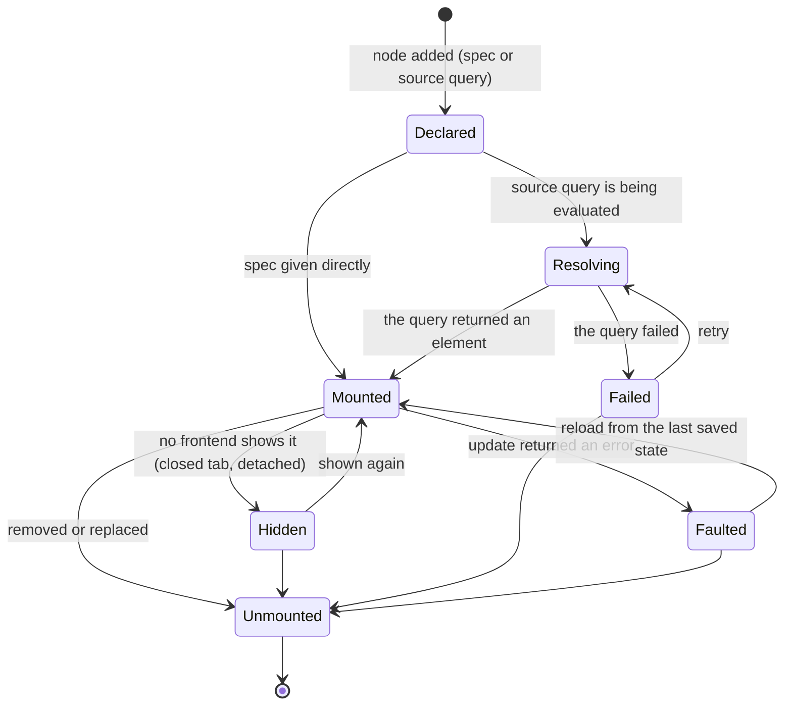

# UI redesign: master design

Written 2026-11-23 at Orest's request. It covers the whole redesign at the level of a Phase 1
(what and why) and a Phase 2 (architecture), so it is longer than the phase limits allow for one
design. Designs D1–D21 of the [plan](./plan.md) rely on it: each of them refines one part and may
not contradict it without changing this document first. The problems it answers are in the
[review of the current architecture](./current-architecture-review.md) (F1–F11).

**Status: proposed, not approved.** Revised on 2026-11-23 after Orest's review: elements may be
written in a frontend's own idiom or in a portable style (§3.4, §5.2), and the client of a split
UI may be anything from very thin to thick (§16). A second round the same day fixed the
vocabulary (§4.1): an element has implementations, a split implementation has a client part and a
server part, and a monolithic implementation or a server part may use the environment directly.
Signatures are sketches that fix the shape, not final code.

**Verification.** Stage 1 of spike S1 built the runner of §12 under egui, a terminal, a retained
host and a split pair ([findings](../../archive/2026-11-23-ui-runner-spike.md)). What it
confirmed and what it corrected is marked "S1" below. Stage 2 ran the same runner in a browser:
a DOM host, hand-written DOM and Leptos views, thick, mixed and thin generic clients over
WebSocket, and a very thin HTML client
([findings](../../archive/2026-11-24-ui-runner-spike-web.md)); its results are in §12.2.

**Contents.** 1 Requirements · 2 Answer in short · 3 Which abstraction · 4 Concepts ·
5 Elements · 6 Lifecycle · 7 Messages and events · 8 Turns · 9 Effects and subscriptions ·
10 The view tree · 11 Frontends: three patterns over one store · 12 Session and runtime ·
13 Transparency · 14 Elements as data, commands, UISpec · 15 Values and display forms ·
16 Split mode: parts, client forms, protocol · 17 Sessions and identity · 18 Theme and style · 19 Input, keymap and
controls · 20 Persistence and addresses · 21 Python and JavaScript · 22 Crates and modules ·
23 Threading, wasm and errors · 24 Testing and conformance · 25 Migration · 26 Acceptance
scenarios · 27 Decision register · 28 Open questions · 29 Impact on the plan · 30 Use-case
walkthrough

---

## 1. Requirements

| # | Requirement | Source |
|---|---|---|
| R1 | The UI model does not depend on `liquers-lib` or on a toolkit | goal G1, F9 |
| R2 | egui, web and ratatui are first-class; a new frontend is a new crate | G2, decisions 1 and 3 |
| R3 | The core holds as much logic as possible; a frontend draws and reports input | decision 1, F2 |
| R4 | One abstraction serves immediate mode, retained mode, the DOM and client-server | Orest 2026-11-23 |
| R5 | Monolithic and split run the same elements; any frontend can be a split client | G3 |
| R6 | The lifecycle and the events are explicit, ordered and observable | Orest 2026-11-23, F4, F5 |
| R7 | The UI never waits for a query; expired values are fetched again | F6 |
| R8 | The web is designed in: one thread, retained DOM, CSS, native text input, several mounts | decision 3, plan §1.1 |
| R9 | Elements can be created by queries, saved, restored and sent | F8, VISION "every view is a query" |
| R10 | Python and JavaScript can define elements | `web-ui-define`, `liquers-py-ui` |
| R11 | Data stays where it lives; a client gets what it can show | `ui-split-elements` |
| R12 | Sessions with pluggable identity; several sessions per environment, several mounts per page | G6, F10 |
| R13 | Theme, icons, keymap, MIDI and high-level controls work the same in every frontend | G7, G13, G14 |
| R14 | The old UI keeps working until M7 | plan §6 |
| R15 | An author may pick one frontend and write an element in that frontend's idiom: immediate-mode egui code, DOM and events in the page. Liquers handles how elements interact and combine | Orest 2026-11-23 |
| R16 | The architecture supports thin and thick clients and lets an application choose per data type and use case. The standard web client is "reasonably thick" and under 5 MB: records yes, polars no | Orest 2026-11-23 |
| R17 | Resizable horizontal and vertical layouts and a docking layout are part of the standard set, in every frontend, with the sizes and the arrangement saved and restored. A custom layout can be defined without changing the core (§10.10) | Orest 2026-11-25, from the DPL project |
| R18 | Modal and popup windows are supported, with more than one level of modality. The number of instances of a window type can be limited, for example at most one "New file" window on the screen (§10.11) | Orest 2026-11-25 |

## 2. Answer in short

**Are there fundamental problems in the old architecture?** Yes, three, and they explain most of
the open issues (review §4): state is not separated from presentation, deciding is not separated
from doing, and the tree has no single owner. None of them is "the element draws itself with
native code". That part of the old design was a goal, and it is kept (R15).

**Which abstraction?** One runtime, two ways to write a view, and a free choice of where an
element runs.

1. **One runtime.** A **session** is the single owner of a tree of elements. An **element** is
   state plus `update(msg, cx)`, which reacts to messages (lifecycle, data, input, replies) and
   asks for effects through `cx`; the session performs them. The lifecycle and the message list
   are the same for every element (§6, §7).
2. **Two view styles**, both first-class, mixed freely in one tree (§5):
   - a **native view** is code in a frontend's own idiom: `fn show(&mut self, ui: &mut egui::Ui, …)`
     for egui, a mount/update pair over DOM nodes for the page, a `render` over a ratatui frame.
     The author chooses which frontends to support;
   - a **portable view** is a pure function `view()` that returns a **view tree**: plain data in
     a small closed vocabulary. It is written once and every frontend interprets it.
3. **Implementations and parts.** An element (say, a code editor) is an abstraction with one or
   more **implementations**, each for a frontend type and a protocol. A **monolithic**
   implementation is one piece with direct access to the environment. A **split** implementation
   has a **client part** and, where needed, a **server part**, which talk over a channel. How
   thick the client is follows from what the implementations put in their client parts (§16).

How the four situations are served:

| Situation | Native view | Portable view |
|---|---|---|
| Immediate mode (egui, ratatui) | The frontend calls `show` each frame with the element's state | The frontend walks the view tree each frame |
| Retained mode, DOM | The frontend calls `mount` once and `update` after each change | The core diffs view trees into **patches**; the frontend applies them |
| Client-server, element in the client (thick) | Runs in the client; only data crosses the wire | Same |
| Client-server, element on the server (thin) | Not possible, except a server-side native view that produces HTML | Patches cross the wire, or the server renders them to HTML |

**Is there an obvious best choice?** No single view style wins (§3): native code is the most
natural and the least portable, and a portable view is the reverse. The design therefore fixes
what must be common (ownership, lifecycle, messages, effects, composition) and leaves the view
style, and how an implementation is divided between client and server, to the author. The portable view is what Liquers' own tools use, and what
makes a thin client and scripted elements possible.

## 3. Which abstraction

### 3.1 Candidates

- **A. Model plus one view per frontend, typed messages.** The plan's sketch and
  `ui-split-elements` option C: `ElementModel` with `Down`/`Up` messages, and `EguiView`,
  `WebView`, `TuiView` per element. Jupyter widgets work this way.
- **B. Model-View-Update with a neutral view tree.** Elm, iced, React Native, Flutter's widget
  tree, Xilem, Phoenix LiveView (which sends tree diffs over a WebSocket) and Dioxus (one virtual
  DOM rendered to the web, a webview, a live view and at one time a terminal).
- **C. Reactive signals.** Leptos, Solid: fine-grained signals wired directly to widgets.
- **D. Immediate-mode facade.** One `ui.button("Run")` API in the style of egui, implemented by
  every frontend; element code runs every frame.
- **E. Server-rendered HTML patches.** LiveView or htmx proper: the server sends HTML.
- **F. Abstract retained widgets.** A widget object tree in the style of wxWidgets or Qt, with a
  backend per toolkit.
- **G. Adopt a framework** (Dioxus, iced) instead of building the layer.

### 3.2 Comparison

| | A views per frontend | B MVU + view tree | C signals | D immediate facade | E HTML | F widget objects |
|---|---|---|---|---|---|---|
| Logic in the core (R3) | partly: each view re-implements interaction | yes | yes | yes | yes | partly |
| Immediate mode | natural | walk the tree | awkward: signals want retained widgets | natural | no | awkward |
| Retained and DOM | each view does its own bookkeeping | patches from one diff | natural | needs a diff of the recorded frame, which is B | DOM only | natural |
| Client-server (R5) | client must ship every element's view code | thin client: patches down, events up | signal graph does not cross a wire | every frame would cross the wire | web only | object sync protocol per widget |
| Cost of a new element | one model + N views | one model + one view | one component | one function | one template | one model + widgets |
| Cost of a new frontend | views for every element | one interpreter | one binding layer | one backend | — | one backend |
| Lifecycle visible (R6) | per view, per frontend | one place | implicit in the graph | implicit per frame | server only | per widget |
| Elements from Python/JS (R10) | need a view per frontend | view is JSON-like data | hard | callbacks every frame | templates | hard |
| Test without a toolkit | model only | model and view | needs a runtime | needs a recorder | string compare | no |

- **A** grows as elements × frontends, and that is exactly how the old editor ended up with
  two input paths (F2). A split client needs the view code of every element, so a third-party
  element cannot be shown by a stock client.
- **C** hides the event order inside a dependency graph, the opposite of R6, and has no natural
  form on a wire or in immediate mode.
- **D** is the most pleasant to write, but once the recorded frame has to be diffed for the DOM
  or sent to a client it has become B with a different front door. It is kept as an optional
  authoring style: a builder that produces view nodes.
- **E** serves one frontend. **F** fits neither immediate mode nor the DOM well, and its common
  subset problem is the same as B's without B's benefits.
- **G.** No framework covers egui, a terminal, the DOM and a split mode with Liquers assets,
  queries and commands inside. Dioxus is closest, but its vocabulary is HTML, its state lives in
  hooks rather than in data (R9), and egui is not a target. Its ideas are used; it is not adopted.

### 3.3 The costs of a portable view, and the answers

| Cost | Answer |
|---|---|
| The vocabulary is a common subset; an element cannot draw anything it likes | Native widget nodes with a per-frontend renderer and a required fallback (§10.6); a neutral `Canvas` node; capability levels (§10.7) |
| A view is rebuilt and diffed after each message | Only the element that got the message is rebuilt; bulk data never sits in the tree (tables are pages, charts are windows: §10.5, §15) |
| Short-lived state (hover, caret, scroll position, a half-typed word) does not belong in the model | It stays in the frontend, keyed by the node's stable id, under fixed rules (§10.4) |
| In split mode every interaction costs a round trip | Frontend-owned drafts and scrolling, opt-in events, native widgets with local behaviour, and placing the element in the client (§16.1) |
| egui authors lose `ui.button()` inside elements | The builder of D; an egui-only native widget for the rare case; old elements run fused (§25) |
| The core must own a diff, a patch format and a store | It is one implementation, tested once, instead of bookkeeping in every retained view |

### 3.4 The choice: both A and B, on one runtime

The first version of this document made B the default and native code an escape hatch. Orest's
review (2026-11-23) corrected that: letting each frontend be programmed in its own idiom was the
main point of the old architecture, and it stays (R15). The comparison above still holds, but it
compares view styles, and the three root causes are not about the view style. So:

- **The runtime is common and mandatory**: session, lifecycle, messages, effects, composition.
  This is what fixes the old problems.
- **A (native views) and B (a portable view) are both first-class.** An element type offers a
  portable view, native views for some frontends, or both. A frontend uses the element's native
  view for it if there is one, otherwise the portable view, otherwise a generic view (title,
  status, a display form of its data).
- **Typed `Down`/`Up` messages are never mandatory.** They are needed only when an author
  deliberately puts an element's state on the server and its native view on the client
  (§16.3). Monolithic native code keeps `&mut` access to its state.
- **D** (builder) remains as authoring sugar for B. **E** (server-rendered HTML) returns as one
  client form, the very thin web client (§16.2).

What each style is for:

| | Native view | Portable view |
|---|---|---|
| Written | once per frontend the author cares about | once |
| Feels like | egui, the DOM, ratatui | Liquers |
| Runs in | frontends it was written for | every frontend, including ones written later |
| Thin client | no | yes |
| Python / JavaScript element | one callback per frontend | one callback |
| Tested without a toolkit | state and `update` only | state, `update` and view |
| Typical use | an application built for one platform; rich widgets (code editor, chart, grid) | Liquers' built-in tools, `UISpec` documents, scripted elements |

The cost of offering both: frontends carry two paths, the documentation must teach when to use
which, and a tree can contain elements a given frontend cannot show natively. The generic view
makes that case visible instead of broken.

## 4. Concepts

```text
  Environment (store, assets, commands)                         one per process
        │ evaluates queries, delivers asset events
  ┌─────┴──────────────────────────── Session ─────────────────────────────────┐
  │  mailbox ──► turn: route msg ► Element.update(msg, cx) ► effects           │
  │                                   │                                        │
  │  tree of nodes ── each: handle, source query, element (state), lifecycle   │
  │                                   │ view()                                 │
  │                              view trees ──► diff ──► patches               │
  └───────────────────────────────────┬────────────────────────────────────────┘
                                      ▼
                                 View store ◄──── (split: a copy, fed over a transport)
                                      │  frames (revision, patches)      ▲ input events
                 ┌────────────────────┼────────────────────┐             │
            egui frontend        DOM frontend         ratatui frontend ──┘
            (walk per frame)    (apply patches)       (walk per frame)
```

| Term | Meaning |
|---|---|
| **Session** | One running UI: a tree of nodes, their elements, a mailbox. The single owner of all UI state. |
| **Node** | A place in the tree: a handle, an optional source query, a lifecycle state, at most one element. |
| **Handle** | The stable identity of a node within a session (kept from today). |
| **Element** | State plus `update`, with a portable view, native views, or both. Lives in a node. |
| **Native view** | An element's drawing code for one frontend, in that frontend's idiom. |
| **Client form** | One kind of client, from very thin (HTML fragments) to thick (most elements local). |
| **Message** | The only input of an element (§7). |
| **Effect** | A request an element makes of the runtime: subscribe, evaluate, add a child, set a timer (§9). |
| **View tree** | What an element looks like now, as data. Made of **view nodes** with **keys**. |
| **Patch** | One change to a view tree. A **frame** is the patches of one turn with a revision number. |
| **View store** | The current view trees of a session and their revision. What a frontend reads. |
| **Frontend** | An interpreter of the view store for one toolkit, plus the host loop (window, terminal, page). |
| **Display form** | A value prepared for showing: text, a table page, an image, a chart (§15). |

### 4.1 Vocabulary for split mode (agreed with Orest, 2026-11-23)

| Term | Meaning |
|---|---|
| **Element** | The abstraction of a piece of UI, possibly with several implementations. Example: a code editor. Identified by its type name. |
| **Element implementation** | The element for one frontend type and one protocol: "code editor, egui, monolithic"; "code editor, web, thick client". |
| **Monolithic implementation** | One piece in one process. It has no client/server split and needs no protocol, though it may use messages internally (§5.4). |
| **Client part, server part** | The two parts of an implementation that supports split mode. The server part is optional when the web API is enough. |
| **Channel** | What connects the two parts: WebSocket, Tauri IPC, MQTT, an in-process queue (spike S2's `Connection`). |
| **Protocol** | The messages the two parts exchange. An implementation defines its own, built where possible from the standard protocol elements (§16.3). |

**Who may use what.**

- A **monolithic implementation** and a **server part** have the environment and every value
  type at hand. They may call it directly: evaluate, read a store, hold a DataFrame.
- A **client part** has no environment. The environment and some values (a polars DataFrame)
  cannot travel through a channel. The client part reaches them through messages to its server
  part, or through the Liquers web API.
- The one constraint on direct access is the old lesson F6: slow work must not run inside a turn
  or a frame. It is spawned, or done through the runtime's services (§9), and its result comes
  back as a message.

Three rules follow from the three root causes:

1. **State is separate from presentation.** An element's state, `update` and saved form never
   mention a toolkit. Drawing code is a separate piece: a portable view in the core, or a native
   view that lives in or beside a frontend crate.
2. **Deciding is separate from doing.** `update` decides and describes; the session does.
3. **One owner.** Only the session touches the tree. Everything else sends it messages. A native
   immediate-mode view gets its element's state lent by the session for the frame (§8.1).

## 5. Elements

### 5.1 The common part

```rust
/// One UI element: its state, how messages change it, and what it looks like.
pub trait Element<E: Environment>: MaybeSend + 'static {
    /// Registered type name, e.g. "asset_view". Used to save and re-create the element.
    fn type_name(&self) -> &'static str;

    /// The only place the state changes. Must not block or await; asks for effects through `cx`.
    fn update(&mut self, msg: Msg<E>, cx: &mut Cx<'_, E>) -> Result<(), Error>;

    /// The portable view, if the element has one. Pure: no effects, no I/O.
    fn view(&self, vx: &ViewCx<'_>) -> Option<View> { None }

    /// The state to save or send, as data. `ElementFactory::create` is its inverse.
    fn save(&self) -> Result<serde_json::Value, Error>;

    /// Title for tabs, windows and the inspector.
    fn title(&self) -> String { self.type_name().to_string() }
}
```

- `E` is the environment type (Phase 1 question 2, agreed). It appears only on the engine side:
  `Element`, `Msg`, `Cx`, `Session`. `View`, `Patch`, the view store and every frontend are not
  generic, so a split client needs no environment at all.
- `ViewCx` gives read-only context a view may depend on: the node's handle, whether it has focus,
  the frontend's capability level and size class (§10.7), the resolved theme's names. Views that
  depend on it stay pure functions of (state, context).
- An element holds no `Arc<Mutex<…>>` to anything shared and no asset references it polls. Its
  saved state holds no toolkit object.

A complete portable element, to show the shape:

```rust
pub struct AssetView { query: Query, sub: Option<SubId>, snap: Option<Snapshot> }

impl<E: Environment> Element<E> for AssetView {
    fn type_name(&self) -> &'static str { "asset_view" }

    fn update(&mut self, msg: Msg<E>, cx: &mut Cx<'_, E>) -> Result<(), Error> {
        match msg {
            Msg::Lifecycle(Lifecycle::Mount) => {
                self.sub = Some(cx.subscribe(Subscribe::query(&self.query).display(Want::Best)));
            }
            Msg::Data(_, snapshot) => self.snap = Some(snapshot.display_only()),
            Msg::Input(Input { key, event: InputEvent::Activate }) if key == "reload" => {
                if let Some(sub) = self.sub { cx.refresh(sub); }
            }
            other => cx.pass(other),          // not mine: bubble to the parent
        }
        Ok(())
    }

    fn view(&self, _vx: &ViewCx<'_>) -> Option<View> {
        let body = match &self.snap {
            None => View::progress(None),
            Some(s) => View::display(&s.display).status(s.status),
        };
        Some(View::column().child(body).child(View::button("Reload").key("reload")))
    }

    fn save(&self) -> Result<serde_json::Value, Error> { /* {"query": …} */ }
}
```

The real code lists every `Msg` variant instead of `other =>` (CLAUDE.md match rule); a
`cx.pass_unhandled(msg)` helper keeps that short.

### 5.2 Native views

A native view is registered in a frontend for an element type. The trait belongs to the frontend
crate, so the core never learns about it, and it is written the way that toolkit is normally
used.

```rust
// liquers-ui-egui: immediate mode. Plain egui code with direct access to the state.
pub trait EguiView<E: Environment>: Element<E> {
    fn show(&mut self, ui: &mut egui::Ui, cx: &mut Cx<'_, E>);
}

// liquers-ui-web: retained DOM. Build nodes once, then bring them up to date; events send messages.
pub trait DomView<E: Environment>: Element<E> {
    type Dom;
    fn mount(&self, parent: &web_sys::Element, cx: &DomCx<'_, E>) -> Result<Self::Dom, Error>;
    fn update_dom(&self, dom: &mut Self::Dom, cx: &DomCx<'_, E>) -> Result<(), Error>;
}

// liquers-ui-tui: immediate mode over a ratatui frame; keys arrive as messages or through `cx`.
pub trait TuiView<E: Environment>: Element<E> {
    fn render(&mut self, area: Rect, frame: &mut ratatui::Frame, cx: &mut Cx<'_, E>);
}
```

The same asset view, native in egui:

```rust
impl<E: Environment> EguiView<E> for AssetView {
    fn show(&mut self, ui: &mut egui::Ui, cx: &mut Cx<'_, E>) {
        match &self.snap {
            None => { ui.spinner(); }
            Some(s) => show_display(ui, &s.display),
        }
        if ui.button("Reload").clicked() {
            if let Some(sub) = self.sub { cx.refresh(sub); }
        }
        ui.text_edit_singleline(&mut self.note);      // a `note: String` field: direct mutation,
                                                      // as in any egui app
    }
}
```

Rules:

- **`update` still exists** and still receives the lifecycle, data, replies and timers. For a
  native immediate-mode element it is usually short ("subscribe on `Mount`, store the snapshot on
  `Data`"), which matches the old design's "few events".
- **Input in immediate mode is handled in `show`**, by egui's own response values, and may change
  the state directly. It does not have to become a message. Effects still go through `cx`, so
  subscriptions, evaluations and tree changes stay ordered and visible.
- **Input in the DOM is events**, which is the web idiom: a listener calls `cx.send(msg)` or
  `cx.with_state(|state| …)`, and each runs as a turn. `update_dom` runs after any turn that
  touched the element.
- **Children.** A native view places a child with `cx.show_child(ui, handle)` (egui, ratatui) or
  `cx.child_slot(handle)` (a DOM node the frontend fills). The child may be native or portable;
  the parent does not know. A portable view places a child with a `Child(handle)` node, and that
  child may be native. So the two styles nest in both directions.
- **Registration.** `egui_views.register::<AssetView>()` in the frontend's own registry, keyed by
  the element's type name. An application registers its native views when it builds its frontend.
- **Shared helpers.** The portable interpreter of each frontend is public (`show_view(ui, &view)`,
  `show_display(ui, &display)`), so native code can use portable pieces for the parts it does not
  care to hand-write.
- **What a native view gives up:** it runs only where its frontend and the element are in the
  same process (monolithic, or a client that has the element), it cannot be shown by a thin
  client, and its direct state changes appear in the trace as "state changed during frame"
  without a message (§13).

### 5.3 Implementations and parts

An element type has a set of registered implementations. A host picks the one that fits its
frontend type and its mode.

| Shape | Pieces | Runs | Environment access |
|---|---|---|---|
| **Monolithic native** | one piece with a native view | monolithic | direct |
| **Split native** | a client part with a native view; a server part if the web API is not enough | split; also monolithic, by joining the parts with an in-process channel | server part: direct. Client part: none |
| **Portable** | one piece with a portable view | monolithic; split with the generic client (the piece is then the server part) | direct |

- An author who writes the split shape gets a monolithic implementation for free (the two parts
  joined in one process). The reverse does not hold: a monolithic native implementation cannot be
  split without being rewritten as two parts.
- A viewer whose value can travel may have **no server part**: a client part plus the web API.
- `Element<E>` of §5.1 is the trait of a monolithic implementation and of a server part. `cx`
  gives it the environment (`cx.environment()`), besides the effects of §9.
- A client part is a separate, smaller trait that is not generic over the environment:

```rust
/// The client half of a split implementation. No environment, no server-side value types.
pub trait ClientPart: MaybeSend + 'static {
    fn type_name(&self) -> &'static str;
    /// Messages from the server part, from the web API, from input, and the lifecycle.
    fn update(&mut self, msg: ClientMsg, cx: &mut ClientCx<'_>) -> Result<(), Error>;
    fn view(&self, vx: &ViewCx<'_>) -> Option<View> { None }      // or a native view (§5.2)
}
// ClientCx: send(to server part), the standard protocol elements of §16.3 (subscribe to a query,
// get and set an accessor, fetch a blob), timers, focus, child placement.
```

- The registry key is (element type, frontend type, client form). It matches the endpoint per
  client form of §16.2: both sides must agree on which implementation of an element is in use.

### 5.4 Does a monolithic implementation use messages?

It does not have to. Open point, to be settled with Orest ("idiomatic versus portable"):

- **Without messages.** Idiomatic immediate-mode code changes its state in `show` and calls the
  environment through `cx`. Simplest to write. It still receives lifecycle and data messages in
  `update`, because those come from outside the frame.
- **With messages.** Input becomes messages handled in `update`. The implementation then gains a
  full trace and replay (§13), can be tested without a toolkit, and is one step from the split
  shape.

The runtime supports both. The recommendation is: no messages required for a monolithic native
implementation; messages for Liquers' own built-in elements.

## 6. Lifecycle

A node goes through these states. The session moves it; nothing else can.



| State | What the user sees | Element gets |
|---|---|---|
| Declared, Resolving | A placeholder drawn by the session: title, progress, cancel | nothing (no element yet) |
| Failed | The error and a retry button, drawn by the session | nothing |
| Mounted | The element's view | all messages |
| Hidden | nothing | data and replies still; `view` is not called |
| Faulted | The last view with an error banner and a reload button | nothing until reloaded |
| Unmounted | nothing | nothing, ever |

**Guarantees.** They are the contract of R6, and each is a test in D1.

1. `Mount` is the first message an element gets, exactly once. Its saved state has already been
   restored by the factory, so `Mount` is where it subscribes.
2. `Unmount` is the last message. After it the element gets nothing, and the session cancels its
   subscriptions, timers and pending requests. An element never has to clean up to be correct.
3. Parents mount before children; children unmount before parents.
4. `Hide` and `Show` come in pairs between `Mount` and `Unmount`. A subscription made with
   `pause_when_hidden` stops refreshing while hidden and refreshes once on `Show`.
5. Replacing the element of a node is `Unmount` (old), `Mount` (new) on the same handle, and
   increases the node's **generation**. A reply, a data update or an input event addressed to an
   older generation is dropped and traced. This is the "node replaced during an evaluation" case
   that `web-ui-use` found to be normal on wasm.
6. The placeholder, failure and fault views are drawn by the session with ordinary view nodes, so
   they look the same in every frontend and no element implements them.
7. A part of a split implementation is told when its other part is reachable (`PeerConnected`)
   and when it is not (`PeerGone`), and the runner holds messages for a part that does not exist
   yet. S1 found this missing: a server part's first message was sent before any client existed.

## 7. Messages and events

One enum is the complete list of what can happen to an element:

```rust
pub enum Msg<E: Environment> {
    Lifecycle(Lifecycle),        // Mount, Show, Hide, Unmount
    Input(Input),                // from one of this element's view nodes: { key, event }
    Control(ControlEvent),       // a high-level function: zoom, pan, rotate, step, select (§19)
    Data(SubId, Snapshot<E>),    // a subscription changed: status, display form, progress, error
    Reply(RequestId, Reply<E>),  // the result of a one-shot effect
    Timer(TimerId),
    Child(Handle, ChildEvent),   // a child was added, removed, retitled, or passed a message up
    Custom(CustomMsg),           // a name and a JSON payload: from commands, other elements, scripts
    System(SystemEvent),         // theme changed, capabilities changed, locale changed
}
```

**Input events** are normalised once, in the core's terms, and are the same from every frontend:

| Event | Sent by | Carries |
|---|---|---|
| `Activate` | button, menu item, link, list row (click, Enter, tap) | — |
| `Change` | text field, toggle, choice, slider, split ratio, tab | the new value, an edit sequence number |
| `Submit` | text field, form | the value |
| `Select` | list, tree, table | the selected keys or range |
| `Range` | virtual list or table | the rows now needed (§10.5) |
| `Expand` | tree, group | key, open or closed |
| `Key` | a node that listens for keys | key, modifiers |
| `Pointer` | a node that listens for the pointer | kind, position inside the node, buttons |
| `Focus`, `Blur` | focusable nodes | — |
| `Drop` | a node that accepts drops | text, or a reference to dropped bytes |
| `Resize` | a node that listens for its size | size in layout units |
| `Widget` | a native widget | a name and a JSON payload |

Rules:

- **Opt-in.** A view node lists the events it listens to. A frontend sends only those, so a split
  client does not flood the server with pointer moves nobody reads.
- **Addressing.** An input event is addressed to (handle, generation, node key). The session
  drops it if the generation is stale or the key no longer exists in the current view.
- **Bubbling.** An element that does not handle a `Key`, `Control` or `Custom` message passes it
  on (`cx.pass`). It then goes to the parent element, and after the root to the session's keymap
  (§19). This is the scope order of `keyboard-shortcuts`.
- **One path.** Every input reaches the element through `update`. A frontend never edits state.
  This removes the two input paths of F2.
- **Open where it must be.** The enum is closed so that a `match` stays exhaustive, and
  open through `Custom` and `Widget`, which carry names and JSON.

## 8. Turns

The session is one task with one mailbox. It processes one message at a time, to completion:

1. **Wait** for a message. There is no polling; an idle session uses no CPU.
2. **Route** it to its node. Drop it if the node is gone or the generation is stale.
3. **Update.** Call `update(msg, cx)`. `cx` records effects; nothing has happened yet.
4. **Perform** the effects in the order they were requested. Tree changes apply now. Anything
   slow (an evaluation, a write) is spawned, and its result comes back later as a message.
   Messages to other elements go to the back of the mailbox.
5. **View.** For each element that got a message this turn and is shown: call `view()`, diff
   against its previous view, collect patches. (An element may call `cx.unchanged()` to skip
   this.)
6. **Publish.** If there are patches or host commands, increase the session revision, write the
   frame to the view store and wake the frontends.

Properties:

- **Run to completion.** `update` never awaits and is never re-entered. The order of state
  changes is the order of the mailbox, and that order is recorded (§13).
- **Batching.** If more messages are waiting, steps 2–5 repeat (up to a limit) before step 6, so
  a burst gives one frame.
- **Coalescing.** In the mailbox, a newer `Data` for the same subscription replaces an older
  unprocessed one, and likewise pointer moves and `Resize` for the same node. Spike S2 showed
  the protocol needs this; doing it in the mailbox gives it to monolithic mode too.
- **Settled.** A session is settled when the mailbox is empty and no request or first evaluation
  is pending. `SessionHandle::settled()` waits for that. It is the race-free "idle" that
  `egui-native-app` needed, and what tests wait on.
- **Never blocks** (R7). A five-second query is a spawned evaluation; the session keeps taking
  turns for everything else.

### 8.1 Who drives the session

The session is a plain object with a non-blocking `run_pending()` and an async `run()`. Two
drivers exist, and the turn rules above are the same under both.

- **Task-driven.** `run()` is spawned as a task. Used on a server, with retained frontends, and
  whenever only portable views are shown. Frontends read the view store.
- **Frame-driven.** An immediate-mode host owns the session on its UI thread. Each frame it calls
  `run_pending()` to process waiting messages, then draws: for each shown element the session
  lends `&mut` to its native view (or hands its current view tree to the interpreter). When a
  message arrives between frames, the session's waker asks the toolkit for a repaint. No lock is
  needed, because the session and the drawing are on one thread; evaluations run elsewhere and
  only send messages. In a page there is one thread anyway.

A native view that changes state during a frame marks the element changed; the session then
treats the frame as a turn for that element (dependents are notified, the saved state is marked
dirty, the trace gets a record).

## 9. Effects and subscriptions

Everything an element can cause, as methods on `Cx`:

| Group | Effects |
|---|---|
| Data | `subscribe(Subscribe) -> SubId`, `unsubscribe`, `refresh(SubId)` |
| Bindings | `bind(accessor) -> SubId`, `set(SubId, value) -> RequestId` (uses `set_if`; a conflict comes back as a reply) |
| One-shot | `evaluate(query, Want) -> RequestId`, `run(action) -> RequestId`, `cancel(RequestId)` |
| Time | `after(duration) -> TimerId`, `every(duration) -> TimerId`, `cancel_timer` |
| Tree | `add_child(ElementSpec, Position) -> Handle`, `remove(Handle)`, `replace(Handle, ElementSpec)`, `move_node`, `set_source(Handle, Query)` |
| Messages | `send(Handle, CustomMsg)`, `pass(msg)` (bubble), `emit(ChildEvent)` (to the parent) |
| Frontend | `focus(key)`, `scroll_to(key)`, `copy(text)`, `open_link(url)`, `download(name, bytes)`, `notify(text)`, `close_window` |
| Self | `unchanged()`, `mark_saved_state_changed()`, `trace(text)` |

- Ids (`SubId`, `RequestId`, `TimerId`, new `Handle`s) are allocated by `cx` at once, so an
  element can store them in the same `update`.
- **Frontend effects** travel in the frame as *host commands* and are executed by whichever
  frontend is attached. They are requests: a terminal may ignore `download`.

**Subscriptions.**

```rust
Subscribe::query(&q)            // what
    .display(Want::Table { rows: 0..100 })   // the display form wanted (§15)
    .refresh(Refresh::OnExpiry)              // OnExpiry (default) | Manual | Every(duration)
    .pause_when_hidden(true)
```

- The **session** owns the subscription: it asks the asset manager, listens to the asset's
  events, prepares the display form off the turn, and sends `Data(sub, snapshot)`. A snapshot
  carries the status, progress, error, metadata summary and the display form. This is
  `ui-asset-snapshot-boundary`, moved into the runtime.
- An element may hold **any number** of subscriptions (value, log, a related query): AC-8.
- **Expiry.** With `Refresh::OnExpiry`, when the asset expires the session requests it again and
  sends the new snapshot; meanwhile the old display form stays, marked stale. This closes
  `UI-ELEMENT-KEEPS-AN-EXPIRED-VALUE-AND-NEVER-RE-REQUESTS`.
- Changing what is wanted (another page of a table) is `cx.resubscribe(sub, …)`; it does not
  re-evaluate the query, only prepares another display form of the same value.
- `Want::Raw` gives the value itself (`Arc<State<E::Value>>`). It works only in the process
  that holds the value, and is how `liquers-lib` elements reach a DataFrame directly.

## 10. The view tree

### 10.1 Shape

```rust
pub struct View { pub root: ViewNode }

pub struct ViewNode {
    pub key: NodeKey,              // stable within the element
    pub kind: NodeKind,            // what it is, with its properties
    pub layout: Layout,            // size, grow, alignment, gap, padding
    pub style: StyleRef,           // roles and classes, never colours (§18)
    pub listen: EventMask,         // which input events it reports
    pub label: Option<String>,     // accessible name; tooltip
    pub enabled: bool,
    pub children: Vec<ViewNode>,
}
```

All of it is `Serialize + Deserialize + PartialEq + Clone`, with no closures and no pointers.

### 10.2 Vocabulary

A closed, versioned set. The first version, by level (§10.7):

| Level | Layout | Content | Input | Structure |
|---|---|---|---|---|
| **0** required | `Column`, `Row`, `Scroll`, `Group`, `Separator`, `Spacer` | `Text` (styled spans), `Heading`, `Status`, `Progress`, `Display` (as text) | `Button`, `TextField`, `Toggle`, `Choice`, `List` | `Child(handle)`, `Empty` |
| **1** standard | `Tabs`, `Split`, `Grid`, `Overlay` (dialog, popup), `MenuBar`, `Menu`, `Toolbar`, `StatusBar` | `Markdown`, `Code` (spans from the core), `Icon`, `Image`, `Link`, `Display` (table, image) | `TextArea`, `Number`, `Slider`, `Tree`, `Table` | `Widget` |
| **2** rich | `Dock` | `Chart`, `Canvas` | `Editor` | — |

- `Child(handle)` is the slot where a child element's own view tree is shown. Composition of
  elements is therefore part of the view, and containers (tabs, splits, windows) are ordinary
  elements whose views contain `Child` nodes.
- `Display` shows a display form (§15) in the best way the frontend can.
- `Canvas` is a neutral 2D drawing list (lines, rectangles, paths, text) for custom graphics:
  the egui painter, SVG in the page, braille cells in a terminal.
- Adding a node kind is a change to `liquers-ui` and a new vocabulary version. That is
  deliberate: the vocabulary is the contract between elements and frontends, so it changes in
  one place. What must not need a core change is a new *element* or a new *native widget*.

### 10.3 Identity

- A `NodeKey` is given by the element (`.key("run")`) or derived from the node's position.
  Dynamic lists must give keys (row ids), as in every keyed-diff system.
- A view node's global identity is (handle, node key). Frontends use it for their own state, for
  DOM ids and for addressing input.

### 10.4 Which state lives where

| State | Owner | Saved | Example |
|---|---|---|---|
| **Model state** | the element | yes | the query text, the selected tab, the split ratio, expanded tree nodes, the table page and sort |
| **Frontend state** | the frontend, keyed by node identity | no | hover, pressed, caret position, pixel scroll offset, IME composition, animation, the draft of a focused text field |

Rules for the cases that are both:

- **Text fields own their draft while focused.** The frontend shows what the user typed at once
  and sends `Change` with an increasing edit sequence (on every edit, or only on commit: the node
  says which). A patch to the value of a focused field is applied only if it answers the latest
  edit sequence; an older echo is dropped. Typing therefore never jumps, in any mode.
- **Scrolling is the frontend's.** The element can ask for `scroll_to(key)`; virtual lists
  report the rows they need with `Range`.
- **Focus is the session's** (which node has it is model-level, for keymaps and scopes); the
  frontend reports `Focus`/`Blur` and obeys `focus(key)`.

### 10.5 Large content

A view tree never contains bulk data. A `Table` or `List` node carries the row count, the column
descriptions and the rows of the window that is loaded; when the user scrolls, the frontend sends
`Range`, the element resubscribes with the new window, and a patch brings the rows. Images and
other bytes are referred to by a **blob reference** (id, media type, size), resolved in-process
by pointer and in split mode by a separate fetch (§16). Charts carry a data window chosen by the
visible range (D15).

### 10.6 Native widgets

```rust
NodeKind::Widget { name: String, props: serde_json::Value, fallback: Box<ViewNode> }
```

- A frontend crate registers renderers by name (`"echarts"`, `"codemirror"`, `"egui_plot"`). It
  receives the properties and their changes, keeps its own native state, and sends `Widget`
  events up. If no renderer is registered, the fallback is shown.
- This is where rich, toolkit-specific behaviour goes: a code editor engine, a chart library, a
  map. It is also where the typed `Down`/`Up` idea of `ui-split-elements` lives on: properties
  down, events up, per widget type.
- A widget may keep fast interaction local (panning a chart) and report only the result (the new
  visible range), which is how round trips are avoided where they would hurt.
- The fallback is required, so every view shows *something* in every frontend (AC-4).

### 10.7 Capabilities

Each frontend declares what it can do: its vocabulary level, its registered native widgets, its
display forms (can it show images?), its layout unit (cells or pixels) and its size class
(compact, medium, wide). The session uses them in two ways:

- **Degrading.** A node kind or display form the frontend lacks is replaced by a fixed rule
  before the frame is published: `Chart` → table of the data → text; `Image` → its label;
  `Split` → `Column`; `Editor` → `TextArea`. The rules are part of the core, so degradation looks
  the same everywhere and a frontend can start at level 0.
- **Adapting.** `ViewCx` exposes the level and size class, so a view can choose a compact layout
  on a phone or in a narrow terminal.

### 10.8 Layout

The frontend computes the layout with its own engine (CSS flexbox, egui layouts, ratatui
constraints). The core uses a small flex-like model they all can express: direction, gap,
padding, alignment, and a size per axis of `Auto`, `Fill(weight)` or `Fixed(units)`. A unit is
one text line high and one character wide in a terminal, and the base spacing token in a GUI, so
`Fixed(20)` means "about twenty characters" everywhere. Pixel-exact layout is out of scope for
the common vocabulary and belongs to native widgets.

### 10.9 Children, slots and layout data (proposed 2026-11-24)

**Children stay an ordered list**, as in the old design, and the relative commands of the old
`lui` namespace (first, last, before or after a handle) keep working unchanged. The list covers
most containers: a panel, a toolbar, tabs, a splitter (two children, which may be layouts), a
grid with a fixed number of columns that grows in one direction, and a dock layout built from
nested splitter and tab elements. Orest (2026-11-24) asked what the list cannot do.

- **A slot** is only the place where a parent draws one child. A portable view names it with a
  `Child(handle)` node; a native immediate-mode view calls `cx.show_child(ui, handle)` there
  (S1); a native retained view (DOM, Leptos, Slint) gives the host a node marked with the
  child's handle, which is not built yet (§28 S1-f). Slots do not change the child mechanism.
- **What the list cannot hold is per-child layout data**: the cell and span of a child in a
  free grid, or the role of a child in a window (sidebar, body, footer). Kept in the parent's
  properties as a second array matched by index, it breaks: a command adding a child cannot say
  where it goes, removing a child shifts the indices after it, and a role moves to the wrong
  child when an optional one is absent.
- **Proposal: a child may carry optional layout data that only its parent interprets.** The
  runner keeps it with the child (see the test results below). This is the attached-property pattern of
  XAML (`Grid.Row`), CSS (`grid-area`) and Flutter. The data is structured like element
  properties, so no key syntax is needed.

```yaml
grid:
  columns: 12
  children:
    - chart: {query: ...}
      layout: {row: 0, col: 0, colspan: 8, rowspan: 2}
    - table: {query: ...}
      layout: {row: 0, col: 8, colspan: 4}
    - log: {}
      layout: {row: 2, col: 0, colspan: 12}
```

- The command or message that adds a child may carry layout data; the parent receives it with
  `ChildAdded` (§7). Changing it later is a message to the parent. In a query, it is ordinary
  command arguments (a grid command taking row, column and spans).
- A linear container ignores layout data and uses the order. A parent that needs layout data
  and gets none chooses a default (the next free cell, the body role).
- Saved state (§20) needs nothing new: the layout data is part of the parent's state.

**Format and notation (settled 2026-11-25).** Layout data is one flat map from a key to a
scalar (number or string). It is the same in a UISpec (`layout: {row: 0, col: 8}`), in a message
and in a command. In a command it is a trailing list of key and value pairs, which is the
dictionary shape of a variadic argument (`shape: map`, merged in PR #288; see
`specs/guides/COMMAND_REGISTRATION_GUIDE.md`). A `lui` command that takes layout data declares it
last:

```rust
register_command!(cr, async fn add_child(state, position: String, reference: String,
    layout: BTreeMap<String, serde_json::Value> multiple, context) -> result
    namespace: "lui")?;
```

What follows from the shape, with nothing for the UI to implement:

- A value that reads as a number is a number, anything else is a string. **There are no
  booleans**: `closable-true` arrives as the string `true`, so a key with a yes or no meaning is
  read by its parent with the usual text rules (`true`, `false`, `yes`, `no`).
- A key given twice and a key without a value are errors found when the plan is built, with the
  position in the query.
- A recipe or a pipeline gives the same argument as a plain object (`layout: {row: 0, col: 8}`),
  and the command editor shows it as rows of a key and a value added together.
- The MCP tool schema of the command describes it as an object.
- Values are scalars. A nested value (a list of breakpoints, say) does not fit in a query and
  belongs to the parent's properties.

```
ns-lui/add-child-current-row-0-col-8-colspan-4      a cell in a free grid
ns-lui/add-child-root-role-sidebar-size-240         a role in a window, with a fixed size
ns-lui/add-right-current-weight-2                   dock: a new pane right of the current one
ns-lui/layout-current-colspan-12                    change the layout data of an existing child
```

Keys are a shared vocabulary, so that a key means the same thing under every parent:

| Case | Parents | Keys |
|---|---|---|
| Order only | panel, toolbar, menu, uniform grid | none; the position words `first`, `last`, `before`, `after`, `instead` |
| Share of space | row, column, splitter | `size` (fixed), `weight` (share of the rest), `min`, `max` |
| Alignment in the given space | any | `align`, `valign`: `start`, `center`, `end`, `stretch` |
| Free grid | grid, dashboard, form | `row`, `col`, `rowspan`, `colspan` |
| Role | window, page, border layout, card | `role`: `header`, `footer`, `left`, `right`, `body`, `sidebar`, `toolbar`, `status` |
| Label of the child in its parent | tabs, accordion, menu, form row | `title`, `icon`, `closable` |
| Free position | canvas, floating windows, overlay | `x`, `y`, `w`, `h`, `z`, `anchor` |
| Dock | dock layout | new position words `left`, `right`, `above`, `below`, `tab` relative to a reference; `weight` |

- Docking is a position relative to a reference, so it extends the position words and needs no
  layout data of its own.
- A parent ignores a key that does not apply to it and reports a key it does not know.
- Not covered on purpose: rules that depend on the size of the screen. They belong to the
  parent's properties, not to a child.
- Orest (2026-11-24): this works, and it is a general convention, a dictionary of scalars as
  a variadic argument, useful for other commands too. It is the key-value case of the feature
  `COMMAND-COMPOSITE-VARIADIC-ARGUMENTS` (`specs/issues/`), which should define it once for all
  commands. That feature is implemented (design `composite-variadic-arguments`, complete,
  PR #288 merged 2026-11-25), so the `lui` commands use it from the start and no command pairs
  up strings itself.
- The exact command signatures are D2's, checked with `liquers-validate`.

**Tested 2026-11-25** in the spike workspace with a free grid in a terminal, in egui, as HTML
and across the runner protocol, thick and thin
([findings](../../archive/2026-11-25-ui-runner-spike-layout.md)). The proposal holds, with these
corrections:

- **The runner keeps the layout data on the child's node; the parent keeps nothing.** The parent
  gets it with the list of its children. `ChildAdded` does not carry it. A snapshot and a
  mirrored tree then contain it with no extra work.
- The tree part of the runner protocol carries `layout` in `Added` and has one more message,
  `Layout { handle, layout }`. A change redraws the parent only.
- A free grid needs a declared or measured row height in a terminal and in egui (§10.8).
- Open: a client request to change layout data (drag to resize).

**Layout data are hints (Orest, 2026-11-25).** Each frontend may implement a subset of the keys,
and a key it does not implement is not an error. The add command may define more complete data
than the shared vocabulary above, for example a size in characters as well as in pixels, so that
each frontend takes the one it can use. This replaces the rule above that a parent reports a key
it does not know.

- **A universal layout grammar (Orest, 2026-11-25).** There is one codified grammar for layout
  data that is checked centrally and understood by several frontends, if not by all. Beside it
  there may be specific grammars for certain elements or frontends. This is the model of CSS: a
  standard that every engine reads, where an engine may ignore a property it does not implement,
  plus properties that belong to one engine.
  - *Universal*: the keys of the table above, each with a codified value type (a number, a
    number with a unit, or one of a set of words) and codified units (characters, pixels, a
    share of the rest). It lives in the core crate as data, so the check, the command editor,
    the MCP schema and the documentation read the same definition. A value that breaks it is an
    error when the command runs, whatever the frontend.
  - *Specific*: a grammar owned by an element type or by a frontend, with keys that are told
    apart from the universal ones by a prefix (as `-webkit-` in CSS). Its owner checks it; the
    others pass it on untouched and ignore it.
  - *Hints*: a frontend that does not implement a valid universal key ignores it. Each frontend
    publishes which keys it implements, so a conformance table can be generated.
  - To be designed with the layout elements (D2 and the layout part of D12): the exact keys and
    value types, how a unit is written in a query (`size-20ch`, `size-240px`), the spelling of
    the prefix, and whether the same grammar also describes the properties of a parent.
- **Removing a key (proposed, not decided).** Separate commands, not an empty value:
  `ns-lui/layout-current-colspan-12` sets or replaces the keys given and keeps the others;
  `ns-lui/remove_layout-current-colspan-rowspan` removes the keys named, and all of them when
  none is named. An empty value stays a value (`title-` is an empty title), and the command
  editor shows two plain commands: a dictionary to set, a list of keys to remove.

### 10.10 Resizable layouts, docking and custom layouts (proposed 2026-11-25)

Requirement R17. The DPL project found that the UI has no docking layout and no resizable
horizontal or vertical layout. Orest (2026-11-25) also asked whether a UISpec should be able to
define a custom layout, since a layout is only an element that interprets its children and their
layout data in a certain way. That is the model of §10.9, and the answer is yes, at three levels.

**Resizable split.** `Split` is a level 1 node and its divider can be dragged. The sizes are the
`size` and `weight` layout data of the children (§10.9), so they are saved, restored and set by
a command with no new mechanism. While the user drags, the frontend owns the position, as it
owns the draft of a text field (§10.4); when the drag ends it reports the new sizes. In split
mode this is the client request to change layout data that §10.9 left open, so the runner
protocol needs it (`RequestLayout`, beside `RequestAdd` and `RequestRemove`). In a terminal the
divider moves with the keyboard.

**Docking.** A dock arrangement is a tree of splits and tab groups, so its saved form is plain
elements and layout data, the same in every frontend. `Dock` stays a level 2 node for drag and
drop between panes, where each toolkit has its own way. A frontend without it shows the same
tree as nested `Split` and `Tabs` nodes, and the position words `left`, `right`, `above`, `below`
and `tab` still rearrange it by command. Docking is therefore usable at level 1 and comfortable
at level 2.

**Custom layouts.**

1. *A layout written as an element.* Any element may be a layout: it reads its children and
   their layout data and returns a view of portable nodes (`Row`, `Column`, `Split`, `Grid`,
   `Tabs`, `Overlay`) with `Child` slots. It is registered like any element, in Rust, Python or
   JavaScript, works in every frontend, and needs no change to the core. The spike grid of §10.9
   is one in about sixty lines.
2. *A layout defined in a UISpec, with no code.* A named layout is a template: a tree of
   existing layouts with named places. A child chooses its place with the `role` key. This
   covers page shapes (sidebar, toolbar, body, status), dashboards and form rows, and it is the
   "components" part of D12.

   ```yaml
   layouts:
     workbench:
       split: {direction: horizontal}
       children:
         - place: sidebar
           layout: {size: 30ch, min: 20ch}
         - column:
             children: [{place: toolbar}, {place: body, layout: {weight: 1}}, {place: status}]
   root:
     workbench:
       children:
         - tree: {query: ...}
           layout: {role: sidebar}
         - editor: {}
           layout: {role: body}
   ```

   A place takes several children when its template says how (a column, tabs). A child with no
   role goes to the place the template marks as the default. A custom layout may declare its own
   layout keys; they are a specific grammar in the sense of §10.9 and are checked the same way.
3. *A layout that computes positions* (flow, masonry, a timeline). This needs code, so it is an
   element as in 1, and it needs two things the vocabulary does not have yet: a free-position
   node (the `x`, `y`, `w`, `h` keys of §10.9 as a container) and the size it was given, as a
   message when the size changes. Both are small, and both are open (§28).

Not tested. The split, the dock tree and a template layout are candidates for the next spike
step.

### 10.11 Modal and popup windows, instance limits (noted 2026-11-25)

Requirement R18, a note from Orest (2026-11-25). Not designed yet; what the design has to cover:

- **Modal and popup windows**, possibly with different levels of modality. The levels to
  consider: a popup that does not block (a menu, a tooltip, a notification); a window that
  blocks its parent element only; a window that blocks its whole window or tab; a window that
  blocks the session. The `Overlay` node of §10.2 (dialog, popup) is the place in the view
  vocabulary; who receives input while a modal window is open is a question for the session
  (§12) and for focus (§19).
- **A limit on the instances of a window type.** A type may say how many instances may be on
  the screen, for example at most one "New file" window. Asking for one more then brings the
  existing one to the front. It has to be decided whether the limit is a property of the element
  type, of the command that opens the window, or both, and whether it counts per session or per
  frontend attached to the session.

## 11. Frontends: three patterns over one store

```rust
/// The read side a frontend holds. Not generic; the same in monolithic and split mode.
pub struct ViewStoreReader { /* current trees, revision, frames since a revision */ }

/// The write side: where a frontend sends what the user did.
pub trait EventSink: MaybeSend { fn send(&self, event: UiEvent); }   // never blocks
```

For portable views, a frontend is given a `ViewStoreReader`, an `EventSink` and a way to be
woken, and does not know whether the session is in its process. For native views it holds the
session (frame-driven, §8.1) or the session's handle, and calls the views registered with it
(§5.2). A frontend chooses per element: native view if registered, else portable view, else the
generic view.

- **Immediate pattern** (`liquers-ui-egui`, `liquers-ui-tui`). Each frame: take the current view
  trees (an `Arc` swap, no lock held while drawing), walk them, draw each node kind, and send
  input events. The session's wake-up calls the toolkit's repaint request, so a change made from
  another thread shows at once (`PY-UI-CHANGE-DOES-NOT-WAKE-AN-OPEN-WINDOW`). Today's
  extract-render-replace dance and the tree lock disappear.
- **Retained pattern** (`liquers-ui-web`, the Slint spike). On each frame of patches: create,
  update, move or remove the native object for each node, kept in a map from node identity. The
  core provides the patch walker; the frontend provides "create a button", "set its label". Input
  listeners are attached once per mount root and resolve the node identity from the target, so
  two mounts in one page never see each other's events (`WEBUI-SHORTCUTS-RUN-IN-EVERY-MOUNT`).
- **Server-side pattern.** A frontend may also run on the server and drive a remote device: it
  consumes patches (or calls a server-side native view that returns HTML) and sends its own wire
  format to a small client. The very thin web client works this way (§16.2).
- **Static pattern.** Render the current trees once to a string: HTML for a server-rendered
  first paint, plain text for tests and for "print". The DOM frontend can adopt server-rendered
  HTML because node identities are in the markup.

**Patches** (the retained and wire form):

```rust
pub enum Patch {
    SetRoot    { handle: Handle, generation: u32, node: ViewNode },
    RemoveRoot { handle: Handle },
    Insert     { at: NodePath, index: usize, node: ViewNode },
    Remove     { at: NodePath },
    Move       { at: NodePath, to_index: usize },
    SetProps   { at: NodePath, changes: PropChanges },   // only the fields that changed
}
pub struct Frame { pub revision: u64, pub patches: Vec<Patch>, pub host: Vec<HostCommand> }
```

The diff is keyed, per element, and lives in the core. AC-5 follows: an immediate frontend draws
the new tree next frame; a retained frontend gets patches naming only the changed element.

## 12. Session and runtime

```rust
pub struct Session<E: Environment> { /* tree, mailbox, registry, keymap, focus, theme, trace */ }

#[derive(Clone)]
pub struct SessionHandle { /* mailbox sender, handle allocator, view store */ }

impl SessionHandle {
    pub fn send(&self, target: Target, msg: OutsideMsg);          // never blocks
    pub fn reserve_handle(&self) -> Handle;                       // no turn needed
    pub fn add(&self, parent: Handle, spec: ElementSpec) -> Handle;
    pub fn attach(&self, caps: Capabilities) -> Attachment;       // reader + event sink + waker
    pub async fn settled(&self);
    pub async fn snapshot(&self) -> SessionSnapshot;              // for save, resync, inspection
}
```

- `Session::run()` is the loop of §8, spawned as a task or driven by the frame (§8.1). Nothing
  else holds the tree, so **there is no lock** (F3 removed).
- A `SessionHandle` is cheap to clone and `Send`. Hosts, commands, other threads and Python hold
  handles.
- **Several sessions** share one environment: one per window, per page mount, per remote user
  (R12, AC-11). A `UiService<E>` creates, lists and ends them; it is the object that "owns a
  running UI" which F10 found missing.
- The session uses the environment only through its public services: evaluate a query, subscribe
  to an asset, read a value accessor. Queries it evaluates carry the session's principal (§17).

### 12.1 The runner and its host adapters (S1)

"Session" above and "runner" in the discussion with Orest are the same object. Every mode has
one: the monolithic runner, the server runner and the client runner are one implementation in
three roles. S1 built it with no toolkit type in it, and five consumers on four entry points:

| Entry point | Used by |
|---|---|
| `run_pending()`: process the mailbox, never block | every host, once per frame or after a wake-up |
| lend a part and take it back, then perform its effects | `update`; native immediate-mode views |
| `view(handle)` | portable interpreters |
| the list of changes since the last call (added, replaced, removed, updated), and a snapshot | retained host adapters; the server end of the runner protocol |

- **Handles and widgets.** The runner knows no widget. Relating a handle to a widget is the
  **host adapter**'s job. An immediate-mode adapter keeps no map (egui: an id scope per handle).
  A retained adapter keeps a map from handle to its native object and updates it from the change
  list. The server end of the protocol is such a retained adapter whose widgets are remote.
- **Asynchronous Liquers, synchronous main loop.** Evaluations hold a sink that posts into the
  mailbox and calls the host's waker (egui: request a repaint). The host calls `run_pending()`
  in its loop. No second thread is needed; S1 ran the runner with the egui adapter as wasm32.
- **Lending without a lock.** For a native view the runner takes the part out of its node for
  the call, so the runner stays usable and the view can draw its children through it.

### 12.2 The runner on the web (S1 stage 2)

Stage 2 ran the unchanged core in a browser and against a WebSocket server.

- **The DOM host is a retained adapter**: one container node per handle, fed by the change
  list. A portable view is rendered to HTML and morphed into the container, so focus and caret
  survive an update. A child sits in the slot node its parent's view names; the host places
  children again after a parent's update. The waker is one coalesced browser callback, and an
  idle page does no work.
- **A native web view is `mount(node, cx)` returning an update function.** Hand-written DOM
  code and a Leptos component both fit it, and both nest in portable parents. State is reached
  through `cx.with(...)`, which reports the change itself, so S1-c (§28) is a question for
  immediate mode only.
- **Client forms.** One wasm module ran monolithic, thick, mixed and thin generic with the
  stage 1 protocol unchanged. The very thin web client is 68 lines of JavaScript; its server
  side is another retained adapter over the change list, sharing the HTML renderer with the DOM
  host.
- **Size.** The UI runtime's own share of a web client is 316 KB of wasm (110 KB gzipped);
  Leptos adds about 105 KB (30 KB gzipped). The 5 MB goal depends on the Liquers code a client
  carries, not on the UI runtime.

Rules this adds to the design:

1. **A widget's own value belongs to the frontend.** A text field, checkbox, radio group,
   dropdown and slider each hold a value between the user's action and the element's state, as
   do caret, selection and scroll position. When the element runs on the other side of a
   connection, the echo of an older value must not overwrite a newer one; a control run without
   the rule corrupted typed text. The client numbers its inputs, a view says which input the
   server has seen, and the client ignores a value older than its last input. This needs no
   lock and is separate from locking an accessor, which decides who may write the data. It is
   part of the portable vocabulary (§10) and of the view-level protocol (§16.4).
2. **The waker is `Send` only on targets with threads.** A browser callback is not `Send`.
3. **Event listeners post to the mailbox; they do not call into the runner.** A DOM event can
   fire synchronously while the host changes the DOM.
4. **A retained host owns listeners and native views per node** and releases them when the
   node is removed.
5. **The server end of a connection is woken like a host**, not polled.

Open from stage 2: the slot marker for a native retained parent (§10.9), and keyed slots in the
diff so that a re-rendered parent never detaches a child.

## 13. Transparency

R6 asks that the lifecycle and events be visible. Four mechanisms, all in the core:

1. **One list of messages, one state diagram** (§6, §7), documented in the reference and enforced
   by tests. There is no second path.
2. **Trace.** When enabled, every turn writes a record: sequence number, time, target handle and
   element type, the message (summarised), the effects requested, the patches produced, the
   duration, and anything dropped with the reason (stale generation, unknown key). Records go to
   a ring buffer and to any attached observer.
3. **Inspector.** A built-in element shows the tree with each node's lifecycle state, its
   subscriptions with their status, pending requests, the focused node, and the live trace. Being
   an ordinary element, it works in every frontend and in split mode. Its data is also a query
   (`ns-lui/inspect`), so an agent or a test can read it.
4. **Replay.** A saved session snapshot plus a recorded message log reproduces the same states
   and frames, because `update` and `view` are deterministic given their inputs. Bug reports and
   regression tests use it (D21).

Native immediate-mode views are the one place where state can change without a message. The
trace records such a frame as a turn with the reason "changed during frame", so the order of
changes is still visible; what is not recorded is which widget caused it. An author who wants
full tracing or replay for an element sends messages from `show` instead of mutating.

Worked example, "the user presses Run in the query console" (portable view), identical in every
mode:

```text
frontend   Input{handle 7, gen 1, key "run", Activate}  ──►  mailbox      (split: one event frame)
turn 41    route → node 7 (query_console)
           update: cx.evaluate(query, Want::Best) → RequestId 12; state.running = true
           view:   button "Run" disabled, progress shown        → 2 patches
           publish revision 88
…          the query runs in its own task; other turns continue
turn 47    Reply(12, Ok(display))  → update: state.result = display; running = false
           view: result shown                                    → 3 patches, revision 93
```

## 14. Elements as data, commands, UISpec

```rust
#[derive(Serialize, Deserialize, Clone, PartialEq)]
pub struct ElementSpec {
    pub element: String,                 // registered type name
    pub state: serde_json::Value,        // what `save()` returned, or initial properties
    pub name: Option<String>,            // stable name for addresses and bindings
    pub source: Option<String>,          // a query that produces this element instead
    pub children: Vec<ElementSpec>,
}

pub trait ElementFactory<E: Environment>: MaybeSend + Sync {
    fn create(&self, state: &serde_json::Value) -> Result<Box<dyn Element<E>>, Error>;
}
```

- An **element registry** in the session's service maps type names to factories. It replaces
  `typetag`, which does not work across wasm, Python or a wire (F8). An unknown type name mounts a
  built-in "unknown element" that shows the name and the data, so a newer document still opens.
- **Elements as values** (Phase 1 question 3, agreed). A command returns an element as an
  `ElementSpec` inside `liquers-lib`'s `ExtValue::UIElement`-style variant. The spec is data, so
  it can be cached, stored and sent like any value. A node whose source query returns a spec
  mounts it; a query that returns any other value mounts an `asset_view` of that query.
- **`lui` commands** get a `SessionHandle` and the current handle through the payload, and send
  tree operations as messages. `add-child` reserves the new handle with `reserve_handle()` and
  returns at once, so a command never waits for the UI and never locks it (the rule learned in
  `liquers-py-ui`).
- **UISpec** (D12) is a document that compiles to a tree of `ElementSpec`s plus bindings. Layout
  elements (tabs, split, menu) are elements like any other.

## 15. Values and display forms

The core cannot know `ExtValue`, and a view tree must be plain data. So a value is shown through
a **display form**, a closed enum in the core:

```rust
pub enum Display {
    None,
    Text     { text: String, language: Option<String> },
    Markdown { text: String },
    Json     { value: serde_json::Value },
    Table    (TablePage),                 // columns, total rows, the rows of one window
    Image    { blob: BlobRef, width: u32, height: u32, alt: String },
    Chart    (ChartSpec),                 // D15
    Element  (ElementSpec),
    Bytes    { blob: BlobRef, media_type: String },
    Error    { message: String },
}

pub trait Projector<V>: MaybeSend + Sync {
    /// Which forms this value can take, best first.
    fn offers(&self, value: &V) -> Vec<DisplayKind>;
    /// Prepare one form. May be slow; the session calls it off the turn.
    async fn project(&self, state: &State<V>, want: &Want) -> Result<Display, Error>;
}
```

- `liquers-core` values get a projector in `liquers-ui`; `liquers-lib` registers one for
  `ExtValue` (DataFrame → `TablePage` through `RecordView`, image → PNG blob, and so on). An
  application adds its own.
- An element says what it wants (`Want::Best`, `Want::Table{rows}`, `Want::Text`); the session
  intersects that with the frontend's capabilities, so a terminal gets a table or text where a
  browser gets an image.
- When a value offers no wanted form, the projector may convert through a query (the automatic
  edge of `ui-display-conversion`). This closes `UI-WIDGET-DOES-NOT-CONVERT-ITS-VALUE`.
- Only display forms travel to a client; the DataFrame stays on the server (R11).

The capability lookup, the list of forms and the paging contract are D2's to settle.

**Proposed change (2026-11-26).** [presentation-extension.md](./presentation-extension.md)
proposes that the extension point is not the projector but a table of presentation rules, from
a type, an argument kind or a media type and a role to a command or an element. It answers how
an application such as DPL adds viewers for its own values and custom argument editors. Awaiting
Orest.

### 15.1 Values in a client part

A client part has no environment (§4.1). It can still link `liquers-core`, which builds for
wasm32 and holds what needs no environment: queries and keys, metadata, status, errors, the type
registry, command metadata. So a client part parses and edits queries, reads metadata and shows
progress with the server's own types.

**A value does not travel as a Rust value.** It travels as bytes plus metadata, which names the
type identifier and the data format (`VALUE_TYPE_SYSTEM.md`). Client and server therefore need
the same identifiers, not the same Rust `Value` type. The client has its own, smaller value type
(no polars). On arrival there are three outcomes, all existing behaviour:

| Case | Example | Client gets |
|---|---|---|
| Known type, readable format | core types; `Image`; `RecordView` when built with records | a value |
| Unknown type | `polars.DataFrame` | bytes and metadata kept ("degraded"); asking for a value is a typed error |
| No byte form | an accessor, a widget, a JavaScript handle | nothing: it cannot travel |

A degraded value is still showable when the browser understands its media type (an image, text,
HTML), so a client need not construct a value to display it.

Limits to design for:

1. **Tables.** CSV and JSON read back with an inferred schema, and Parquet reads only through
   polars. The standard client includes the Arrow IPC format (`records-ipc`), and table pages
   are sent in it.
2. **Elements as values.** Today `ExtValue::UIElement` holds a trait object with no byte form.
   The element-as-data form of §14 is therefore required, not optional.
3. **The server must know what the client reads before it sends.** This rests on three designs
   in review: `registry-publication`, `realm-type-registry` (a transfer mode per type) and
   `cross-realm-transfer-planning` (a conversion placed on the server, such as DataFrame to
   record view).
4. **Type parameters.** A monolithic implementation and a server part are generic over the
   environment. A client part is generic over a value type only, and gets a small **client
   context**: the type registry, the imported command metadata, and the connection.

A page that needs more runs a real environment over remote services (`liquers-web`), which is
the monolithic case.

**Client profiles (Orest, 2026-11-23).** The server's configuration, as an extension of its
environment, declares each client form it serves and that form's value type:

| Client form | Value type | Known to the server as |
|---|---|---|
| Thin (generic, terminal, HTML) | fixed: the core `Value`, or none at all | built in |
| Thick | configurable, serializable; every thick client of that form must support it | a named profile: the type identifiers and formats it reads (a realm of `realm-type-registry`), and the element implementations it has |

The profile is what tells the server, before it sends anything, which values may go whole, which
must be converted (a DataFrame to a record view) and which elements have a client part. It also
answers S1's finding that the server must know the client form before it creates parts (§28
S1-a): the form is a named profile on the server, chosen by the endpoint.

## 16. Split mode: parts, client forms, protocol

### 16.1 Parts, and who owns what

In a split UI an element is present on both sides under the same handle: a server-side node with
the server part (or with nothing, when the implementation has none), and a client-side node with
the client part. The runtime gives each element a logical channel between its two parts,
multiplexed over the one connection and addressed by (handle, generation).

- **The server part** runs beside the environment and may use it directly (§4.1). It holds what
  cannot travel: a DataFrame, a database cursor, a long evaluation.
- **The client part** holds the view and the interaction, and as much logic as the author puts
  there. It talks to its server part and to the web API.
- **A portable implementation** has only a server-side piece; its client side is the generic
  interpreter, and its protocol is the view level (§16.3 item 4).
- **Each piece of state has one owner.** The state of a client part (a draft, a selection, a
  scroll position) is the client's. The state of a server part is the server's.
- **The tree structure** (which nodes exist, their sources and specs) is proposed to be owned by
  the server in split mode: elements are created by queries that run there, a session can be
  saved and restored there, and a second device can attach. The client mirrors the structure
  and asks for changes, through the runner protocol (§16.1a).

### 16.1a The runner protocol (universal)

Keeping the client's nodes consistent with the server's is not an element's business. It is one
protocol between the server runner and the client runner, the same for every element and every
client form (Orest, 2026-11-23). Element protocols travel inside it.

| Message | Direction | Content |
|---|---|---|
| `Hello`, `Welcome` | both | versions, client form, the implementations the client has, credentials or resume token; session id, theme, limits |
| `Tree` | server → client | the whole node structure at a revision: handles, parents, order, element type, chosen implementation, initial properties |
| `NodeAdded`, `NodeRemoved`, `NodeReplaced`, `NodeMoved` | server → client | one structural change, with the new revision and the node's generation |
| `NodeState` | server → client | lifecycle state of a node (resolving, mounted, failed, hidden), title, status, progress |
| `Focus` | both | which node has focus |
| `Request` | client → server | ask for a structural change (add, remove, move, set source); the answer is the resulting `Node…` message or a refusal |
| `ToPart` | both | an element message for the part with this (handle, generation): the element's own protocol or a standard protocol element |
| `Ack`, `Resync`, `Ping`, `Pong`, `Bye` | both | flow control, recovery, liveness |

- The **client runner** applies these to its own tree: it creates the client part of each node
  (or the generic view when it has none), delivers `Mount`/`Unmount` in the order of §6, and
  routes `ToPart` messages. The lifecycle guarantees therefore hold on the client as on the
  server.
- A `lui` command that changes the tree runs on the server and changes the server tree; the
  client learns of it through `NodeAdded` and the like. No command needs to know that a client
  exists.
- A `ToPart` message for a generation the receiver no longer has is dropped, as in §6.
- The view-level messages of §16.4 are the standard protocol element 4 carried in `ToPart` for
  portable elements; `Hello`, `Ack`, `Resync` and `Ping` there are these same runner messages.

### 16.2 Client forms

How thick a client is belongs to the UI implementation, not to the architecture (R16). The forms
planned, all on the same runtime:

| Form | Client contains | Elements run | Wire carries | Size goal |
|---|---|---|---|---|
| **Monolithic** | everything | in the one process | nothing | — |
| **Thick web (standard)** | wasm: the core, the web frontend, the client parts of the built-in elements, `liquers-core` (parsing), records | client parts in the client; server parts where needed | web API, element messages; view level as fallback | < 5 MB |
| **Monolithic over remote services** | `liquers-web`: an environment in the page whose store and asset manager are remote | monolithic implementations in the page | whatever the environment's remote services use | application's choice |
| **Thin generic** | a view store copy and one frontend's interpreter (egui, terminal, or a small wasm) | on the server | view level: patches | small |
| **Thin terminal** | a terminal | on the server | changed cells down, keys and mouse up | — |
| **Very thin web** | a few kB of JavaScript: apply HTML fragments, report events | on the server | HTML fragments down, events up | tens of kB |
| **Islands** | a very thin page that loads a thick wasm module for chosen elements (editor, chart) | mostly server, some client | both | per island, lazy |

- **The standard web client draws the line at records and DataFrames.** It includes
  `liquers-records` (a table page is a `RecordView`) and not polars. A DataFrame stays on the
  server and the client gets pages.
- **A split client has no environment.** A page that does have one (`liquers-web` with a remote
  store and a remote asset manager) is monolithic from the UI's point of view, even though it is
  a client of some server: its elements are monolithic implementations and call their environment
  directly.
- **A thin client is a frontend that runs on the server while only its device is remote.** For
  the terminal this is the changed cells of the screen going down and keys and mouse events
  coming up; S1 built it over ratatui's buffer diff. For the web it is HTML fragments.
- **The very thin web client is a server-side frontend** (§11): `liquers-ui-web`'s HTML renderer
  runs in the server, turns each element's portable view (or a server-side native view that
  returns HTML) into fragments, and sends a fragment whenever the element changes. It needs no
  wasm, loads at once, and suits simple pages, embedded devices and restricted browsers. It is a
  separate web implementation beside the thick one, and shares the HTML/CSS conventions with it,
  so islands can mix them.
- **Client forms are part of the address.** Each form is a different server component with its
  own wire format, so each gets its own endpoint, for example `api/ui/thick/ws`,
  `api/ui/thin/ws`, `api/ui/html/ws`. The names are D3's to fix.

### 16.3 Standard protocol elements

An implementation defines the protocol between its parts. Most of what implementations need is
the same, so the core defines reusable protocol elements. An implementation uses any of them,
adds messages of its own, or uses none. Nothing here duplicates the web API: where the API
already does the job, the protocol element is the API.

| # | Protocol element | Messages | Carriers |
|---|---|---|---|
| 1 | **Query submission and asset updates** | submit or subscribe, status, progress, value or display form, error, expired, cancel | in process from the asset manager (monolithic, server part); the web API plus asset events on a WebSocket (client part); relayed by the server part |
| 2 | **Value transfer** | display forms, record pages by range, blobs by reference | the web API where it has a route; the channel otherwise |
| 3 | **Accessor** | get, set with `set_if`, changed, conflict | in process; the web API; the channel |
| 4 | **View level** | view-tree snapshot and patches down, input events up | the channel (§16.4) |
| 5 | **HTML fragments** | fragment per element down, events up | the channel |
| 6 | **Runner protocol** (§16.1a, universal, not optional in split mode) | tree structure, node changes, lifecycle state, focus, addressing by (handle, generation), revisions, resync, ping, flow control | every channel |

**Query submission and progress, in every mode.** The old egui UI needed to submit queries and
receive progress updates. That need does not go away in split mode, and it does not depend on a
server existing:

- a **monolithic** implementation cannot rely on a server, so the runtime submits to the asset
  manager in process and delivers the updates as `Data` messages (§9);
- a **server part** has an environment and uses the same in-process service;
- a **client part** gets the same updates from the web API (submit over HTTP, asset events over
  the WebSocket of `asset-events-over-websocket`), or from its server part.

The message shape is defined once (the snapshot of §9), so code that reacts to "progress
arrived" is the same in a monolithic implementation and in a client part.

**Custom messages.** Whatever is specific to an element (a table's "sort by column", an editor's
"apply edit") is the implementation's own typed `Down`/`Up` pair, carried in the envelope. This
is `ui-split-elements` option C, used where an author writes a split implementation, and never
imposed on a monolithic one.

### 16.4 The view-level protocol

**Layers.** Transport (spike S2's `Connection`: ordered opaque frames, `Closed`, `max_frame`) →
protocol messages → view store copy → frontend.

| Message | Direction | Content |
|---|---|---|
| `Hello` | client → server | protocol and vocabulary versions, capabilities, element types the client has, credentials or a session token |
| `Welcome` | server → client | session id, resume token, theme, limits |
| `Snapshot` | server → client | all view trees at a revision |
| `Frame` | server → client | revision, patches, host commands |
| `Event` | client → server | the UI event, and the revision the user was looking at |
| `Ack` | client → server | the last revision applied |
| `Blob`, `BlobRequest` | both | bytes by reference, chunked to `max_frame`, or fetched by HTTP where there is HTTP |
| `Ping`, `Pong` | both | liveness, round-trip time |
| `Bye` | both | reason |

- **Revisions and resync.** Frames are numbered. A client that reconnects sends its last
  revision; the server replays the missing frames if it still has them, or sends a `Snapshot`. A
  client that detects a gap asks for a resync.
- **Flow control.** The server sends at most a window of frames beyond the last `Ack`. When the
  client is behind, the server merges waiting frames (patches compose) or replaces them with a
  `Snapshot`; it never queues without bound. Spike S2 found this missing in every transport.
- **Encoding.** The protocol types are serde types. JSON first (readable in browser tools); a
  compact binary encoding is negotiated in `Hello` later. D3 chooses it.
- Element messages and asset events use the same connection, envelope, ping and flow control.

### 16.5 Versions and offline

- A thin client tolerates a newer server: it only interprets a versioned vocabulary. A thick
  client shares code with the server, so `Hello` carries the versions of the protocol, of the
  web API and of each element implementation; on a mismatch for an element that node falls back to
  its portable implementation, if it has one.
- A thick client keeps showing and editing local state when the link drops, marks its
  subscriptions stale, and re-subscribes on reconnect. Writes go through `set_if`, so a write
  made against an old version is refused as a conflict, not applied blindly. Working fully
  offline is the monolithic-over-remote-services form's concern and is not designed here.

### 16.6 Security

- On the view level a client can only send UI events; evaluation happens on the server under the
  session's principal.
- Through the web API a client part names queries itself. The server therefore applies the access
  policy to every such request (`access-policy-at-entry-points`); a thick client is as
  untrusted as any HTTP caller.
- Event and request sizes and rates are limited per connection (`AXUM-WEBSOCKET-HARDENING`).

## 17. Sessions and identity

- A **session** outlives its **connections**. A dropped connection leaves the session running
  for a grace period; reconnecting with the resume token attaches to it again (§16.1).
- An `Authenticator` turns the credentials of `Hello` (or of the HTTP upgrade request) into a
  `Principal`. Built-in: none (local app), token, trusted proxy header. OIDC and others are
  optional crates, so SSO needs no change to the core. D4 defines the trait.
- The principal is attached to the session and to every evaluation it starts. What it may do is
  decided by `access-policy-at-entry-points`, not by the UI.
- **What a session is.** One runner and one element tree, and with them: one handle space
  (handles mean nothing outside their session), one mailbox (one order of messages), one
  principal, one lifetime, one saved state, one trace. All sessions share the environment, and
  so its assets, stores and cache.
- **Inside a session** an element can message any other element by handle, tree operations can
  touch any subtree (also one shown by another frontend), `lui` commands act on the session they
  run in, and control events can go to the focused element of another frontend. **Across
  sessions** none of that exists: the only bridge is named data in the environment (assets,
  stores, value accessors with change events). No other cross-session mechanism is planned.
- **Which to use.** One user, one task, several devices or windows: one session (a control
  surface, a second window, handover). Different users, different rights, or independent work on
  the same data: separate sessions. A frontend attached to a session acts with the session's
  principal, so a restricted helper device is a separate session. The unit of attachment is the
  subtree (Orest, 2026-11-24).
- **A control surface** that only sets values may be its own session, writing to the same value
  accessors; one that changes trees or steers the focused element of another device joins the
  session.
- **A frontend may be connected to several sessions**: two mounts in one page, or two windows of
  a desktop host. Each attachment has its own tree, focus and shortcuts (D1 AC-11), and nothing
  crosses between them except through the environment.
- **Several frontends may attach to one session, but an element instance is connected at most
  once** (Orest, 2026-11-24). Each frontend is attached to its own subtree, like a window: the
  desktop shows one, a phone shows a control surface. There is never "the same" editor in two
  clients; two editors on two frontends are two element instances over shared data, exactly as
  two editors inside one frontend. Consequences:
  - the client form is known per subtree, so the server knows which parts to run for a node
    (this answers S1-a);
  - elements on different frontends interact through the session: messages between elements
    routed by the server runner, and shared data (assets, value accessors);
  - when a connection drops, its subtree is detached and may be attached again by the same or
    another frontend; the elements get new client parts, and state that lived only in the old
    client part is lost unless it was sent to the server (§20);
  - focus, scroll and layout are per frontend by construction, so no per-viewer state problem
    arises.
- **Observers are not part of the design.** Showing an instance that another frontend already
  shows could only be a read-only copy of its output. That is cheap for a portable view computed
  on the server, needs a relay for one computed in a client part, and is impossible for a native
  client view (that is screen sharing). The first case may be added later.
- In monolithic mode there is one local session and a fixed local principal. No authenticator
  code runs.

## 18. Theme and style

- The token model of `THEME.md` (layers, roles, hues, icons, the `ui:` section) moves to
  `liquers-ui` unchanged (D10).
- View nodes carry **roles and classes**, never colours or fonts: `style: primary`,
  `style: danger`, `class: "toolbar"`. Each frontend resolves them against the session's resolved
  theme: CSS custom properties and selectors in the page, `egui::Visuals` and per-node styles in
  egui, ANSI styles in a terminal.
- The resolved theme is sent once (`Welcome`) and again when it changes
  (`SystemEvent::ThemeChanged`), not with every node.
- A subtree may override tokens: a `Group` node with a theme override is the scope. This is how
  a `UISpec` element changes its own theme (`UI-DOCUMENT-CANNOT-NAME-ITS-THEME`).
- Icons are named (`icon: "play"`); the frontend draws the glyph from the icon set it has, or the
  icon's text fallback in a terminal.

## 19. Input, keymap and controls

```text
device (keyboard, pointer, touch, MIDI, gamepad)
   │ frontend reports raw input for the focused mount
   ▼
input map (core): keymap, MIDI map, gestures   ── runs where the device is
   │
   ├─► an action: a named UI action or a query to run   (menus and palettes list the same actions)
   └─► a control event: { function, value }  →  focused element, bubbling to its parents
```

- **Controls** are the high-level functions of goal G14: `Zoom`, `Rotate`, `Pan2`, `Pan3`,
  `Scalar(name)`, `Step` (previous/next), `Select`, `Trigger`, `Toggle`. An element receives
  `Msg::Control` and does not know whether a wheel, a key or a MIDI knob produced it.
- A view node declares the controls it accepts. That is the hint from which mapping UIs, tool
  palettes and MIDI learn mode are built (D13, D14, D20), and what a touch frontend turns pinch
  into.
- **Keymap scopes** follow the element tree: focused element, its ancestors, the document, the
  application. The first binding that matches wins. A text field that has focus takes plain keys
  first.
- The input map is core code that runs on the side that has the device: in the engine process
  in monolithic mode, in the client in split mode (Web MIDI in the page). It sends actions and
  control events, not raw device data, across the wire.
- Text input stays native: a text field is the toolkit's own (the browser's `<input>`, egui's
  `TextEdit`), so IME, spell-check and accessibility work.

## 20. Persistence and addresses

The old UI had two mechanisms that were never reconciled: create a view from an application
spec, and restore a view from saved state. Saved state could be obsolete or corrupt against the
spec, and the path was never really tested. This design has **one mechanism**:

- **A UI is always created from a spec.** There is no separate restore path.
- **Saved state is an overlay on the spec, per named node.** An entry holds the node's name, its
  element type, a state version chosen by the element, and the data its `save()` returned.
- **Applying the overlay is a checked merge.** When a node is created from the spec, its overlay
  entry is passed to the factory only if the name, the element type and the version match. An
  entry that does not match, or that the factory refuses, is dropped and reported; the node
  starts from the spec. A missing, stale or corrupt overlay can therefore cost saved state but
  cannot stop the UI from opening.
- **Nodes the user added at run time** (a console result, an extra tab) are saved as spec
  fragments under their parent's name, and are dropped with a report if that parent is gone.
- **What is saved.** State on the server side: monolithic implementations and server parts.
  State that lives only in a client part is not saved unless the part sends it to the server
  with a standard "saved state" message (optional, S1-b). Orest (2026-11-23): server-only saving
  is an acceptable limit.
- An element calls `mark_saved_state_changed()`; the session saves on a debounce to wherever the
  host configured (a store key, browser storage).
- **Addresses.** A node with a `name` has a path of names from the root, and an element may add
  its own route segment (the selected tab, a table page). The path is the fragment of a URL in
  the page (back and forward work) and an argument of the desktop and terminal hosts. D7 and D12
  define the syntax.

## 21. Python and JavaScript

Because a view is data and an element's state is data, a scripted element needs no per-frontend
code:

- A **scripted element** type is registered by the integration (`liquers-py`, `liquers-web`).
  Its state is a JSON-like object. The script supplies `update(state, msg) -> effects` and
  `view(state) -> view tree` (dicts and lists that deserialise to `ViewNode`s).
- It then works in every frontend and in split mode, like a built-in one. This generalises
  `web-ui-define`'s `DelegatedElement`.
- Callbacks run inside a turn. For Python the turn takes the GIL for the duration of the call;
  the UI thread never waits for it, because frontends only read the view store.
- A script that needs a toolkit-specific widget registers a native widget in that frontend
  (a JavaScript function that fills a DOM node; a Python callable given an egui `Ui`).

## 22. Crates and modules

```text
liquers-core
   └─ liquers-ui                    the core: no toolkit, no liquers-lib
        ├─ liquers-ui-egui          interpreter (immediate) + native window host
        ├─ liquers-ui-tui           interpreter (immediate) + crossterm host
        ├─ liquers-ui-web           interpreter (retained DOM) + page mount; HTML renderer and the
        │                           very thin client (server side); `DomView` trait
        ├─ liquers-ui-server        UiService over transports, authenticators, session store
        │     └─ liquers-axum (feature `ui`)   WebSocket route, blob route, static client
        ├─ liquers-ui-tauri         shell, IPC transport
        └─ liquers-lib (feature `ui`)   projector for ExtValue, its elements, the `lui` commands
```

`liquers-ui` modules:

| Module | Contents |
|---|---|
| `view` | `View`, `ViewNode`, `NodeKind`, `Layout`, `StyleRef`, builders, keyed diff, `Patch`, `Frame`, the view store, the text renderer, degrading rules |
| `engine` | `Element`, `Msg`, `Cx`, `Session`, `SessionHandle`, the tree, lifecycle, subscriptions, `ElementSpec`, registry, trace |
| `input` | input events, focus, keymap, controls, the input map |
| `display` | `Display`, `Want`, `Projector`, `TablePage`, `BlobRef` |
| `theme` | the token model and resolution (moved from `liquers-lib`) |
| `elements` | built-ins: `asset_view`, `text`, `markdown`, `tabs`, `split`, `window`, `menu`, `query_console`, `inspector`, placeholder, unknown |
| `protocol` | the messages of §16 and the session-side and client-side drivers |
| `transport` | the `Connection` shape of spike S2 and the in-process transport |
| `testing` | the headless frontend and replay |

- **One core crate** for now. The standard thick client uses all of it. A thin generic client
  uses `view`, `input`, `display`, `theme`, `protocol` and not `engine`; a cargo feature `engine`
  (on by default) lets it leave the engine out. If the spike shows that `liquers-core` itself is
  too heavy for a small client, `view` and `protocol` move to a crate with no `liquers-core`
  dependency. Deciding that needs the spike's size numbers.
- **Size.** Orest (2026-11-23): a reasonable size is accepted, but it must be kept down and
  measured. Measured that day (`WEB-RELEASE-MODULE-IS-20-MB`): today's full `liquers-web`, an
  environment in the page with the old UI, is 19.8 MB raw and 4.9 MB gzipped. A size-oriented
  release profile alone brings it to 9.5 MB and 2.7 MB; dropping AVIF, OpenEXR and the other
  unused image formats to 7.0 MB and 2.0 MB; records add 2.0 MB raw. The standard web client of
  this design carries no environment and no command library, so it should come in below these
  figures. Spike S1 stage 2 measured the UI runtime's own share at 316 KB raw and 110 KB
  gzipped (§12.2); a client with Liquers code in it is not measured yet. Polars is not in it. Large native widgets (a code
  editor engine, a chart library) load lazily. The size is reported by CI from D7 on.
- Each frontend crate owns its native view trait (`EguiView`, `DomView`, `TuiView`) and its
  registry.
- The dependency rule of AC-1 holds: nothing above depends on `liquers-lib` except `liquers-lib`'s
  own glue.

## 23. Threading, wasm and errors

- **Send.** Engine types are `MaybeSend` (Send on native, not required on wasm), as elsewhere in
  Liquers. View types are `Send + Sync` everywhere.
- **Native.** The session is a tokio task. Frontends run on the UI thread and never block: they
  swap an `Arc` to read and push to a channel to write.
- **wasm.** One thread: the session is a local task that takes turns between browser events. No
  API anywhere needs `block_on`. Heavy work can later move to a worker behind the same protocol
  (S2 showed `postMessage` fits the transport shape).
- **Errors.** `update` returning `Err` puts the node in `Faulted` (§6): the last view stays, with
  the error and a reload button; the session and the other elements continue. A failed effect is
  not an error of the session: it comes back as a `Reply` or `Data` carrying the error, and the
  element decides what to show. All errors are `liquers_core::error::Error`.
- **No `unwrap`, no stdout**, explicit matches: the repository rules apply to every new crate.

## 24. Testing and conformance

- **Elements without a toolkit.** The headless frontend in `liquers-ui::testing` attaches to a
  session, finds nodes by key or label, sends input, waits for `settled()`, and asserts on the
  view tree or its text rendering. Most UI tests are of this kind and run in the default loop.
- **Frontends without elements.** A fixture set of view trees and patch sequences covers every
  node kind and property. Each frontend renders them under its test backend (`egui_kittest`,
  ratatui's `TestBackend`, a DOM under `wasm-bindgen-test` or Playwright) and reports what it
  drew in a common form. D21 owns the fixtures and the levels.
- **Same events, same states** (AC-3) holds by construction in the core, and is checked end to
  end by replaying one event log through each frontend.
- **Protocol.** Replay of recorded frames; reconnect, gap and slow-client cases over the
  in-process transport with injected faults.

## 25. Migration

- The old UI in `liquers-lib` is untouched and keeps working until M7 (R14).
- **Old elements are native elements.** `liquers-lib` provides a `legacy` element that wraps an
  existing `UIElement`; its `EguiView` calls `show_in_egui` and its `DomView` inserts
  `render_web`'s HTML. Porting an old element to a proper native element is then mostly moving
  code, since `show_in_egui` already is an idiomatic egui view. This is AC-10's "mounted in a new
  tree".
- **What carries over as code:** the editor's state, commands and effects (already this
  pattern), the theme, `UiAction`s and menus, the keymap, the `UISpec` parser, the handle tree
  logic.
- **What is rewritten:** `AppRunner`, `AppState`'s locking, `mount_web`'s loop, `NativeDriver`,
  and the views of the built-in tools (as portable views, once, in the core).
- Built-in elements are ported in the order the plan's milestones need them.

## 26. Acceptance scenarios

Master-level scenarios. D1's AC-1 to AC-11 remain, with AC-4 and AC-5 reworded (§29).

- **M-1 One element, every frontend.** WHEN an element is written once with `update` and a portable `view`
  THEN it is shown and usable in egui, the terminal and the page with no frontend-specific code.
- **M-2 Thin client.** WHEN a client connects to a server that has a portable element type the
  client was not built with THEN the client shows and operates it through the view level.
- **M-3 Same turns in every mode.** WHEN the same input log is replayed monolithically and
  through a transport THEN the trace of turns and the resulting frames are identical.
- **M-4 Visible lifecycle.** WHEN a node is created, resolved, hidden, replaced and removed THEN
  each transition appears in the trace in the order of §6, and the element saw `Mount` first and
  `Unmount` last.
- **M-5 Typing over a slow link.** WHEN the user types in a text field with 300 ms of latency
  THEN every key shows at once and no character is lost or reordered.
- **M-6 Degrading.** WHEN a view contains a chart and a native widget and the frontend has
  neither THEN the chart shows as a table or text and the widget shows its fallback.
- **M-7 Reconnect.** WHEN the connection drops and returns within the grace period THEN the
  client shows the session's current state without a reload, and no input is applied twice.
- **M-8 Scripted element.** WHEN an element is defined in Python or JavaScript as data and two
  functions THEN M-1 and M-2 hold for it.
- **M-9 Idle is idle.** WHEN nothing changes THEN the session takes no turns and publishes no
  frames.

- **M-10 Idiomatic egui.** WHEN an author writes an element with an `EguiView` using ordinary
  egui calls and direct state changes THEN it runs in a Liquers egui application, receives its
  data through `update`, and nests inside and around portable elements.
- **M-11 Idiomatic web.** WHEN an author writes an element with a `DomView` using DOM nodes and
  event listeners THEN it runs in the thick web client beside portable elements.
- **M-12 Thick client.** WHEN the standard web client shows a viewer or editor whose logic is in its client part and
  the server is slow or briefly unreachable THEN the element stays responsive and resumes its
  subscriptions on reconnect.
- **M-13 Size.** WHEN the standard web client is built THEN its wasm is under 5 MB and contains
  no polars.
- **M-14 Very thin web.** WHEN a page uses the HTML endpoint with no wasm THEN portable elements
  are shown and usable, and a chosen element can be loaded as a thick island.
- **M-15 Missing native view.** WHEN a tree contains an element that has only an egui view and it
  is opened in a terminal THEN the node shows the generic view, and the rest of the tree works.

## 27. Decision register

"Earlier" = decided by Orest on the date given. "Proposed" = decided here, pending approval.

| # | Decision | Status |
|---|---|---|
| 1 | One core crate `liquers-ui`, one crate per frontend, `liquers-ui-<frontend>` names | earlier, 2026-11-22/23 |
| 2 | The core is generic over the environment on the engine side only | earlier (Q2), refined here |
| 3 | An element as a value is a `liquers-lib` value variant, now holding an `ElementSpec` | earlier (Q3), refined here |
| 4 | One runtime (session, lifecycle, messages, effects); native views and a portable view are both first-class and nest freely (§3.4, §5) | agreed in principle by Orest, 2026-11-23 |
| 5 | `update` receives every message; effects are requests performed by the session; a native immediate-mode view may also change its own state during a frame | proposed |
| 6 | One session owns the tree; no shared lock; task-driven or frame-driven (§8.1) | proposed |
| 7 | The lifecycle of §6 with its six guarantees; node generations drop stale deliveries | proposed |
| 8 | One message enum; input events normalised in the core, opt-in per node, bubbling | proposed |
| 9 | Turn semantics of §8: run to completion, batching, coalescing, `settled()` | proposed |
| 10 | The session owns subscriptions; expiry refreshes by default; several per element | proposed (absorbs `ui-asset-snapshot-boundary`) |
| 11 | A closed, versioned view vocabulary in three levels; adding a node kind is a core change | proposed |
| 12 | Native widget nodes with a required fallback embed toolkit-specific pieces inside a portable view | proposed |
| 13 | Frontend-owned short-lived state; text fields own their draft while focused | proposed |
| 14 | Bulk data is never in the view tree: windows, pages and blob references | proposed |
| 15 | The keyed diff and the patch format live in the core; frontends follow one of three patterns | proposed |
| 16 | For portable views, frontends see only a view store and an event sink, in every mode | proposed |
| 17 | Client forms from very thin to thick; the standard web client is reasonably thick, under 5 MB, records but no polars; one endpoint per form (§16) | agreed in principle by Orest, 2026-11-23 |
| 17a | The core defines standard protocol elements (§16.3) that implementations reuse; the web API is not duplicated; typed `Down`/`Up` belong to split implementations and are never imposed on a monolithic one | agreed in principle by Orest, 2026-11-23 |
| 17b | A very thin web client (HTML fragments, no wasm) is a separate web implementation, built as a server-side frontend; islands combine it with thick modules | proposed (Orest's suggestion) |
| 18 | Elements are data plus a registered type; a factory registry replaces `typetag` | proposed |
| 19 | Commands reach the UI through a `SessionHandle` in the payload and never wait for it | proposed |
| 20 | Values are shown through a closed `Display` enum prepared by a `Projector` off the turn | proposed (details D2) |
| 21 | View nodes carry style roles; frontends resolve them against the session's theme | proposed |
| 22 | The frontend computes layout from a small flex-like model in character-sized units | proposed |
| 23 | Controls are core events; the input map runs where the device is | proposed (details D13) |
| 24 | Trace, inspector element and replay are part of the core from D1 | proposed |
| 25 | Scripted elements are data plus `update` and `view` callbacks | proposed |
| 26 | Protocol: revisions, ack window, merge or snapshot when behind, blobs by reference, JSON first | proposed (details D3) |
| 27 | One transport shape for all transports; Tauri IPC default in the shell | earlier (S2, 2026-11-22) |
| 28 | Old elements run as native elements through a `legacy` wrapper | proposed |
| 29 | Liquers' own built-in tools are written with portable views, with native pieces where a toolkit piece is needed | agreed by Orest, 2026-11-23 |
| 30 | Vocabulary: element, element implementation (per frontend type and protocol), monolithic implementation, client part and server part, channel, protocol (§4.1) | agreed by Orest, 2026-11-23 |
| 31 | A monolithic implementation and a server part may use the environment and any value directly; a client part has no environment and uses messages or the web API | agreed by Orest, 2026-11-23 |
| 32 | A split client has no environment; a page with an environment over remote services (`liquers-web`) is monolithic | agreed by Orest, 2026-11-23 |
| 33 | Query submission and asset updates have one message shape and three carriers (in process, web API with asset events, relay by the server part) | proposed |
| 34 | The split shape of an implementation also runs monolithically, by joining its parts in process | proposed |
| 35 | In split mode the server owns the tree structure; the client owns the state of its client parts | agreed in principle by Orest, 2026-11-23 |
| 36 | A universal runner protocol keeps the client's nodes consistent with the server's; element protocols travel inside it (§16.1a) | agreed in principle by Orest, 2026-11-23 |

| 37 | The runner is one frontend-independent implementation in three roles (monolithic, server, client); a host adapter per frontend relates handles to widgets (§12.1) | confirmed by S1 |
| 38 | A client part may link `liquers-core` but has no environment; values reach it as bytes plus metadata, and its value type is its own (§15.1) | proposed |
| 39 | Table pages travel as Arrow IPC; the standard client includes it | proposed |
| 40 | Parts of a split implementation get `PeerConnected` / `PeerGone`; the runner queues messages for a part that does not exist yet | proposed (S1) |
| 41 | The server declares client profiles: a thin client has a fixed value type, a thick client a configurable serializable one known to the server (§15.1) | agreed in principle by Orest, 2026-11-23 |
| 42 | One creation mechanism: a UI is created from a spec, and saved state is a checked overlay per named node; only server-side state is saved by default (§20) | proposed; the limit accepted by Orest, 2026-11-23 |
| 43 | Several frontends per session, each attached to its own subtree; an element instance is connected at most once; no observers (§17) | agreed in principle by Orest, 2026-11-24 |

## 28. Open questions

Answered by Orest on 2026-11-23: native and portable styles are both offered (decision 4); thin
and thick clients are both supported and the standard client is reasonably thick (17); built-in
tools are portable (29); the vocabulary and the environment rule (30–32). The order of
implementation is deliberately left aside until the architecture is settled.

Still for Orest:

1. **The runner protocol's message set** (§16.1a): is anything missing for keeping the client
   consistent with the server?
2. **Messages in a monolithic implementation** (§5.4): not required for native code, used by the
   built-in elements. Agreed?
3. **Is the list of standard protocol elements** (§16.3) the right set?

Raised by spike S1 (findings §8), to be decided before D1's architecture:

- **S1-a. The server must know the client form before it creates parts.** Answered: the form is
  a profile known at connect (§15.1), and each frontend attaches to its own subtree, so the form
  is known per subtree (§17). Still open: is the subtree the only unit of attachment?
- **S1-b. State held only in a client part is invisible to the server.** Answered: not saved by
  default; an optional "saved state" message lets a client part opt in (§20).
- **S1-c. A native immediate-mode view must report that it changed state.** Answered
  (2026-11-24): the element is responsible. "Report" is a local flag to its own runner with no
  payload; no state is sent anywhere. It is automatic inside `update` and wherever state is
  reached through `cx` (retained native views: DOM, Leptos, Slint). Only immediate-mode code
  that changes state while drawing makes the one call; a debug build can catch a forgotten
  call by comparing the state before and after the frame.
- **S1-d. A client cannot reserve a handle** for a node it asks the server to add. Client-side
  handle ranges, or request ids?
- **S1-e. One part trait or two?** S1 used one trait for monolithic, server and client parts,
  with different services. §5.3 has a separate `ClientPart`.

- **S1-f. Children and layout data** (§10.9): children stay an ordered list; is optional
  per-child layout data, interpreted by the parent, the right extension for free grids and
  roles? The slot marker for a native retained parent is still to be built. The notation in a
  command is no longer open: it is the dictionary shape of a variadic argument (PR #288).

- **S1-g. Layouts** (§10.10): resizable split and docking as a tree of splits and tabs; custom
  layouts as elements, as UISpec templates with named places, and with computed positions (which
  needs a free-position node and a size message). Is the template form what you meant by custom
  layouts in a UISpec?

- **Windows** (§10.11, R18): levels of modality and instance limits are noted as requirements and
  are not designed.

For the spikes and the sub-designs, not blocking approval:

4. Does the standard client fit in 5 MB with `liquers-core` and `liquers-records` (S1 measures)?
5. Does the vocabulary map cleanly onto Slint's declarative model (S5)?
6. The binary encoding and the blob transfer per transport (D3).
7. Per-viewer state when several users share a session (M6, D4).
8. Focus, keymap scopes and bubbling when parts of the tree are native and parts portable, and
   across the client/server boundary (D1, D3).
9. Accessibility mapping (AccessKit in egui, ARIA in the page) for portable and native views
   (D6, D7).
10. Which web API routes the client parts need that do not exist yet (asset events, record
    pages, accessor writes): D3 and D5 list them against `liquers-axum`.

## 29. Impact on the plan

- **D1 `ui-core-crate`** is the `view`, `engine`, `input` and `testing` modules with the built-in
  level 0 and 1 elements needed for its example, and the hooks a frontend needs to register
  native views. Its AC-4 becomes "a frontend that implements only vocabulary level 0 shows every
  portable element, degraded by the core's rules; an element with no view for that frontend
  shows the generic view".
- **S1** becomes: the draft vocabulary and diff; three frontends (egui, ratatui, DOM) each
  showing the D1 example with one portable element and one native element nested in each other;
  the hard cases of §30 (typing in an editor, a 100 ms live chart, a large table); wasm size and
  frame-time numbers. **S5** is the same for Slint.
- **D2** defines `Display`, `Want`, `Projector` and paging.
- **D3** is the view-level protocol and the envelope shared with element messages and asset events, over S2's
  transports, with one endpoint per client form.
- **D5 `ui-client-side-processing`** becomes: what client parts get from the web API, the
  standard protocol elements 1–3, and the monolithic-over-remote-services form.
- **D6, D7, D8** each provide the portable interpreter, the native view trait and the host. D7
  also owns the 5 MB budget. A new design, **D22 `ui-web-thin-client`**, covers the very thin
  HTML client and islands.
- **D12** compiles to `ElementSpec` trees. **D15**'s `ChartSpec` is a display form and a level 2
  node with native widgets per frontend. **D21** owns the vocabulary fixtures and the
  mixed-style nesting tests.
- The milestones keep their order. M2's content changes from "thin split client" to "thick web
  client plus the view-level protocol".

## 30. Use-case walkthrough

Each tool and situation from the goal list, checked against the design. In the placement column,
"client" means the logic sits in a client part of the standard thick web client, using the web
API and a server part only where noted; "server" means a server-side piece shown through the view
level. In monolithic mode everything is one piece.

| Use case | Written as | Placement (split) | What crosses the wire | Risk, and what answers it |
|---|---|---|---|---|
| Query console | portable | client | evaluate, subscribe | low |
| Value viewers (text, JSON, Markdown, image) | portable | client | display forms; small values whole | low; image size limits (blob references) |
| Menus, tabs, splits, windows, palettes | portable | client | nothing | low; kept from `menu-pane-layout` |
| Docking with drag | portable `Dock` node, native in each frontend | client | nothing | medium: each toolkit docks differently; level 2, own design |
| Asset manager, process monitor | portable | client | asset events, job lists | medium: event volume; coalescing (§8) |
| Orthodox two-pane store manager | portable, keyboard-driven | client | `listdir`, copy, move | medium: very large folders; virtual lists (§10.5) |
| Table viewer over records | portable `Table`; optional native grid | client | pages of a `RecordView` | medium: sort and filter are server queries; paging contract in D2 |
| Table viewer over a DataFrame or SQL | same element | client | pages; the DataFrame stays on the server | medium: latency per page; prefetch |
| Table editor, spreadsheet-like grid | native grid per frontend over a shared core model | client | cell edits through accessors or commands | **high**: formulas, undo, selection models differ per toolkit; research before D16 |
| Text and code editor | shared core model (document, diagnostics, save) + native editor engine per frontend (egui `TextEdit`, CodeMirror, a ratatui text area) | client; whole text in the client | load, save with `set_if` | **high**: three engines, IME, large files; S1 hard case |
| Query, template and recipes editors | the existing editor state/commands/effects + portable view + the text engine | client; validation runs in the client with the published command registry | registry, validation of unknown commands | medium: registry publication (D5) |
| Charts, live (100 ms) | `ChartSpec` display form; native widget per frontend (`egui_plot`, ECharts, braille) | client | data windows, appended points | **high**: pan and zoom must be local, live updates must coalesce; S1 and S3 hard case |
| Chart from Python (matplotlib) | display form `Image` or `Chart` | server evaluates, client shows | image or spec | low |
| Markdown or help page with embedded queries | portable | client | display forms | low |
| `UISpec` application | portable elements plus bindings | client | accessor reads and writes | medium: binding conflicts; `set_if` |
| An egui application for one platform (`stockplottertest`) | native egui elements | monolithic | nothing | low; this is the old style, kept |
| Python-defined element | scripted, portable | server (the Python process) | view patches to any client | medium: GIL during callbacks (§21) |
| JavaScript-defined element | scripted, portable or `DomView` | client (page) | web API | low |
| MIDI and controls | input map on the device side | client or monolithic | control events only when the logic is in a server part | medium: latency; keep interactive logic in the client part |
| Tauri desktop | thick web client in the webview, environment in the Rust process, IPC transport | client | web API and element messages over IPC | low (S2 measured IPC) |
| Tauri mobile, phone browser | thick web client, compact size class | client | web API over HTTP and WebSocket | medium: background suspension; reconnect and resync (§16.5) |
| Terminal over SSH | monolithic TUI | — | nothing | low |
| Terminal or egui as a remote client | thin generic (view level) or thick native | either | patches, or web API and element messages | medium: two paths to test |
| Very thin web page, restricted browser | server-side HTML frontend | server | HTML fragments, events | medium: typing latency; islands for editors |
| Embedded device ("lqe") | device serves the web API, or HTML fragments; UI runs on the phone or laptop | client, or server for HTML | asset updates and element messages over MQTT or WebSocket | medium: small frames, broker limits (S2) |
| Several users on one UI | shared server parts, or shared data under separate client parts | either | view level, or accessor events | **high**: per-viewer focus and selection; M6 |
| Unreliable network | logic in client parts | client | re-subscribe on reconnect | medium: offline writes not designed (§16.5) |

**Reading of the table.** Nothing on the list fails to fit. The three high-risk items that
touch M1–M4 are the text editor, the live chart and the editable grid; each is a native piece
per frontend around a shared core model, which is the case §5.2 and §10.6 exist for. They are
the hard cases of spike S1, so that a problem shows before D1's architecture is fixed.
