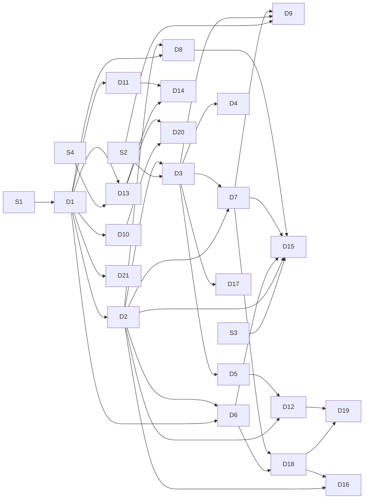

# UI redesign: plan

A sketch for review, written 2026-11-22 from the [idea map](./idea-map.md). Nothing here is
approved. Each **D** below becomes its own `liquers-project` design (`specs/design/<slug>/`) when
its milestone starts; the slugs are proposals. Sizes use `DOCS_STRUCTURE_GUIDE.md` §4.5.

## 1. Target architecture (sketch)

```text
                   liquers-core ── liquers-records (optional, table pages)
                        │
                   liquers-ui            model crate: tree, handles, AppState, runner, events,
                        │                ElementModel/ElementView traits, protocol types, theme,
                        │                icons, UISpec, controls (function mapping), client driver
      ┌─────────┬───────┼──────────┬───────────────┐
 liquers-ui-egui  liquers-ui-web  liquers-ui-tui  liquers-ui-server ── liquers-axum (feature `ui`)
  (egui views,     (DOM views,     (ratatui views,  (sessions, WebSocket,      │
   native host,     CSS, ECharts,   crossterm host)  auth hook)          liquers-ui-tauri
   egui_plot)       wasm client)                                         (IPC transport, shell)
      └─────────┴───────┬──────────┴───────────────┘
                   liquers-lib            models and projections for ExtValue (DataFrame → RecordView
                                          page, image → PNG), the `lui` commands; depends on the UI
                                          crates, never the reverse
```

- **Model and views.** A splittable element is an `ElementModel` (authoritative state, asset
  subscriptions, `Down`/`Up` messages) plus one view per frontend (`EguiView`, `WebView`,
  `TuiView`). Monolithic = in-process transport with values by pointer; split = an encoding
  transport (WebSocket, Tauri IPC). Today's `UIElement` survives as a *fused element* behind an
  adapter, so the old and new UI run side by side (decided 2026-11-17).
- **Frontends are crates.** Adding a frontend adds a crate and view impls; `liquers-ui` never
  learns about it. Three first-class frontends from the start validate the traits: egui
  (immediate), web (retained DOM), ratatui (cells).
- **Data stays where it lives.** The client receives projections (pages, PNG, chart data windows)
  unless it declares the type (`realm-type-registry`); light work may run in a client environment
  (realms), heavy work on the server.
- **Identity is pluggable.** An `Authenticator` produces a `Principal`; the access policy of
  `access-policy-at-entry-points` decides; IdP-specific code lives in optional crates.

The crate split itself (how many crates, where the server half lives) is question Q1.

## 2. Designs

| # | Proposed slug | Scope | Size | Covers (issues, absorbed designs) | Depends on |
|---|---|---|---|---|---|
| D1 | `ui-core-crate` | `liquers-ui` crate: tree, handles, `AppState`, events; `ElementModel`/view traits; non-blocking runner with several subscriptions per element; fused-element adapter; migration rules; rewrite of `UI_INTERFACE_FSD.md` | XL | `UI-NOT-SEPARATED-BY-CRATE-AND-TECHNIQUE`, `UI-INTERFACE-FSD-DESCRIBES-UNBUILT-API`, `WEB-UI-FREEZES-WHILE-A-QUERY-AWAITS`, `UI-ELEMENT-KEEPS-AN-EXPIRED-VALUE…`, `EGUI-ASSET-MANAGER-INTEGRATION`; absorbs `ui-asset-snapshot-boundary`, reuses `ui-split-elements` | spikes S1, S2 |
| D2 | `ui-value-projection` | How a model shows a value without `liquers-lib`: display capabilities, projections (text, `RecordView` page, PNG/SVG, chart data), conversion by automatic edge, what may travel | L | `UI-WIDGET-DOES-NOT-CONVERT-ITS-VALUE`; absorbs `ui-display-conversion` | D1; `value-interface-capability-split`, `realm-type-registry` |
| D3 | `ui-protocol-and-transport` | Protocol messages, envelope, revisions, resync, session vs connection, capabilities in `hello`; in-process and WebSocket transports; `liquers-ui-server`; `liquers-axum` route; client driver | XL | `WEB-UI-CANNOT-BE-DRIVEN-BY-A-REMOTE-ENGINE`, `AXUM-CANNOT-SERVE-A-LIQUERS-UI`, `AXUM-WEBSOCKET-HARDENING`; uses `axum-websocket-connection-limits` | D1, D2 |
| D4 | `ui-auth-and-sessions` | `Authenticator` trait and `Principal`; built-ins (none, token, trusted proxy header, local app); optional OIDC crate; session store, lifetime, reattach, joining another user's session | L | `CORE-SESSION-AND-KEY-ACL`, `SECURITY-SENSITIVE-SETTINGS-ARE-NOT-DOCUMENTED` (auth part) | D3; `access-policy-at-entry-points` |
| D5 | `ui-client-side-processing` | Client as an environment with its own realm; which commands run where; accessor descriptors; remote store from the client | L | `ACCESSOR-CANNOT-BE-SENT-TO-A-CLIENT`, `WEB-HAS-NO-READ-WRITE-REMOTE-STORE` | D3; `multi-realm-dispatch`, `registry-publication`, `remote-store-and-asset-manager` |
| D6 | `ui-egui-frontend` | `liquers-ui-egui`: views for the built-in elements, native host (move `NativeDriver`/`run_window`), theme → `Visuals`, egui as split client | L | `EGUI-EXAMPLES-HAND-WRITE-THE-FRAME-LOOP`, `PY-UI-CHANGE-DOES-NOT-WAKE-AN-OPEN-WINDOW` | D1, D2 (D3 for client mode) |
| D7 | `ui-web-frontend` | `liquers-ui-web`: DOM views (from today's `ui/web`), CSS, monolithic wasm mount and the default split client, `liquers-web` `mountUI` on top, a client build without polars | L | `WEBUI-SHORTCUTS-RUN-IN-EVERY-MOUNT`, `WEB-ONEVENT-SHOW-GUARD-IGNORES-THE-MOUNT`, `WEB-MOUNTUI-HAS-NO-THEME-OPTION`, `WEB-RELEASE-MODULE-IS-20-MB` | D1, D2, D3 |
| D8 | `ui-tui-frontend` | `liquers-ui-tui`: ratatui views and crossterm host, theme → ANSI styles, Unicode icons; split client over WebSocket | L | — (new) | D1, D2 |
| D9 | `ui-tauri-shell` | Tauri 2 desktop shell: IPC or loopback transport, single local session, packaging template; mobile as a later phase | M | — (new) | D3, D7; S2 |
| D10 | `ui-theme-portable` | Theme model moved to `liquers-ui`; TUI mapping; `liquers-theme` CLI (validate, compose, CSS/DTCG export); more icon sets and icon assets; namespace metadata; style queries for element kinds and states | L | `NO-RENDERER-NEUTRAL-STYLESHEET`, `ICON-SETS-OTHER-THAN-PHOSPHOR-ARE-NOT-DRAWN`, `NAMESPACES-HAVE-NO-METADATA`, `UI-DOCUMENT-CANNOT-NAME-ITS-THEME`, `PY-COMMAND-CANNOT-SET-ICON-PRESETS-OR-NEXT` | D1 (the move); style queries after D12 Phase 1 |
| D11 | `ui-configuration` | `UiConfig` extended (frontend sections, start document, keymap, MIDI, session settings); one typed reader for every host | M | `HOSTS-READ-CONFIGURATION-DOCUMENTS-DIFFERENTLY`, `WEB-STORE-CONFIG-NOT-APPLIED-THROUGH-ENVIRONMENT-CONFIG` | D1 |
| D12 | `ui-spec-v2` | `UISpec` as an application language: accessor bindings, forms, actions, components and includes, docking, per-element theme overrides, validation; likely splits into *bindings and forms* and *layout and components* | XL | `VALUE-ACCESSOR-CANNOT-LOCK`, `YAML-DOCUMENT-EDIT-DROPS-COMMENTS`, `UI-ELEMENT-NESTED-IN-CONSOLE-HAS-NO-HANDLE`, `COMMAND-COMPOSITE-VARIADIC-ARGUMENTS` (form side), later `ACCESSOR-CANNOT-BE-IMPLEMENTED-IN-PYTHON-OR-JAVASCRIPT`; absorbs `console-mounts-nested-element` | D1, D2; D5 for split forms |
| D13 | `ui-function-mapping` | Controls vocabulary (scalar, angle, vec2, vec3, range, choice, step, trigger, toggle); command and element hints; sources (pointer, keyboard, touch, gamepad); unified keymap and focus scopes | L (research first) | `UI-EVENTS-HAVE-NO-POINTER-DRAG-OR-CHANGE-KINDS`, `WEB-EDITOR-HAS-NO-KEYBOARD-MODEL` (keyboard) | D1; spike S4 |
| D14 | `ui-midi-mapping` | MIDI as a control source: device profiles, mapping file, learn mode, ranges, relative encoders, soft takeover, feedback; `midir`, Web MIDI, Tauri | M | — (new; lessons from `egui-midi-test`) | D13, D11 |
| D15 | `ui-charts` | `ChartSpec` common subset; egui `egui_plot`, web ECharts, ratatui charts; per-frontend extensions; static SVG/PNG; `ns-chart` commands; downsampling | L | — (new; reference `stockplottertest`) | D2, D6, D7, D8; spike S3 |
| D16 | `ui-table-tools` | Paged table viewer/editor over `RecordView` for records, DataFrames and SQL; SQL editor and schema browser; spreadsheet-like grid (research) | L | — (new) | D2, D18; `relational-database-access`, `sql-over-tables` |
| D17 | `ui-asset-store-tools` | Asset manager, orthodox two-pane store manager, process monitor (queue, jobs, events, cancel) | L | — (new) | D3 for the server view; `assets-api-admin-operations`, `asset-events-over-websocket`, `unmanaged-asset-registry` |
| D18 | `ui-text-editors` | One editor element with syntax modes (query, template, YAML, JSON, SQL, Markdown, code), diagnostics, save; Markdown editor with preview; per-frontend editor engines | L | `TEXT-EDITOR-EDITS-ARE-NEVER-SAVED`, `TEMPLATE-HAS-NO-HIGHLIGHTER`; absorbs `text-editor-save`, `template-syntax-highlighter` | D1, D6, D7 |
| D19 | `ui-query-template-recipe-editors` | Query editor with live validation on the new crates in every frontend; template editor with integrated query editor; recipes editor with validation and plan preview | L | `UI-QUERY-EDITOR-LACKS-LIVE-VALIDATION`, `WEB-QUERY-EDITOR-NOT-LIVE`, `NO-TEMPLATE-EDITOR-UI`, `CORE-QUERY-EDITOR-ACCEPTS-AN-UNKNOWN-COMMAND`, `EDITOR-CANNOT-EDIT-INSIDE-A-NESTED-PIPELINE`, `WEB-PIPELINE-EDITOR-HAS-NO-DEFINITION-MODE`, `PIPELINE-COMMAND-OPERAND-TYPES-UNCHECKED`; absorbs `query-editor-live-validation`, `web-query-editor-live-preview`, `template-editor-ui` | D18, D12 |
| D20 | `ui-palettes` | Command palette (fuzzy search) and tool palettes of icon buttons from command hints | M | `COMMANDS-HAVE-NO-TOOL-PALETTE` | D10, D13 |
| D21 | `ui-frontend-conformance` | Built-in element set every frontend implements; conformance suite over `UISpec` fixtures per frontend test backend; protocol replay tests | M | — (new) | D1; grows with D6–D8 |

Later, not yet designs: workspace persistence (B6), accessibility and i18n (B7), undo/redo (B8),
graph views (B10), agent workbench UI (B11), other desktop frontends (iced, Slint, Dioxus),
TUI in the browser.

## 3. Spikes before the architecture is fixed

Throwaway branches whose findings go to `specs/archive/` and into D1/D3 Phase 2. Each answers one
question.

| Spike | Question | Feeds |
|---|---|---|
| S1 ratatui | Do the draft `ElementModel` + view traits work for an immediate GUI, a DOM and a terminal? Render asset view, text and a list in all three | D1, D8 |
| S2 Tauri | Tauri IPC (`invoke` + `Channel`) or loopback WebSocket for the split transport; binary throughput, startup, mobile build | D3, D9 |
| S3 charts | Read `stockplottertest`; map one `ChartSpec` (time series + candlestick + bar) to `egui_plot`, ECharts and ratatui | D15 |
| S4 controls | Catalogue functions across `ns-img`, `ns-pl` and charts; drive three of them from keyboard, wheel and a MIDI controller (`egui-midi-test` as base) | D13, D14 |

## 4. Dependencies



The critical path is **S1 → D1 → D2 → D3 → D7 → D9**: the core crate, the value boundary, the
protocol, the web client, Tauri. Everything else hangs off D1/D2 and can run in parallel once they
are approved.

## 5. Milestones (proposed priority)

Each milestone ends with something runnable. The old UI keeps working throughout; only fixes land
on it (Q2).

**M0 — Architecture decided** (no product change). Spikes S1, S2. D1 and D2 through Phase 2, D3
through Phase 1. Exit: the trait signatures and crate layout approved; the "proceed" gates of D1/D2
passed.

**M1 — New core, monolithic egui and ratatui.** D1 and D2 implemented; D6 and D8 for the basic
element set (asset view, text, Markdown, table page, image, layouts, menu); D10 part 1 (theme moved
to `liquers-ui`, TUI mapping); D11; D21 skeleton. Exit: one `UISpec` document runs natively in egui
and in a terminal on the new crates, next to the old UI.

**M2 — Web and split mode.** D3 implemented; D7 (monolithic wasm and the split client); D4 part 1
(single session; `none` and token authenticators; loopback bind by default); D9 desktop. Exit: a
browser, the egui app and a Tauri app attach to a `liquers-axum` UI session and show the M1
document; `ui-split-elements` AC-1..AC-9 pass.

**M3 — Data tools.** D16 (tables, SQL viewer), D15 (charts in three frontends, after S3),
D17 (asset manager, store manager, process monitor), D5 (client-side processing). Exit: the
2-million-row example of `ui-split-elements` with a chart over it, in egui and the browser.

**M4 — Composition and editors.** D12 (bindings and forms first), D18, D19, D20, D10 part 2 (style
queries, icon assets, CLI). Exit: a form over a YAML config file through accessors, a template and
recipes editor, all in a `UISpec` with theme overrides.

**M5 — Inputs.** S4, then D13 and D14; touch gestures. Exit: zoom and pan of an image viewer and a
chart from a MIDI knob, presets on MIDI buttons, without per-command MIDI code.

**M6 — Multi-user and mobile.** D4 part 2 (multi-session, trusted proxy, OIDC crate, joining
sessions), WebSocket hardening, D9 mobile phase. Exit: two users on one server with separate
sessions and key policies; an Android build of the Tauri app.

**M7 — Retire the old UI.** Port the remaining elements, move the `lui` commands onto the new
crates, deprecate `UIElement` and the feature-gated render methods, update the user guides.

Rationale for the order: M0–M2 carry the structural goals (crates, frontends, split, Tauri) that
everything else depends on; doing tools and editors first would mean writing them twice. M3 comes
before M4 because tables and charts are what the split model is for (data on the server) and they
test the projection rules hardest. Inputs (M5) need the controls research, which can start as S4
during M1–M3 without blocking. Multi-user (M6) is last because a single local session covers
desktop, Tauri and development; D4 Phase 1–2 can still be written early so M2 does not preclude it.

## 6. Cross-cutting rules for every design

- **Language integration** (CLAUDE.md): each design records Python (`liquers-py`) and JavaScript
  (`liquers-web`) as in scope, later or not needed. Expected: D1, D7, D10, D12 touch both;
  `liquers-web` exposes D7's mount and client; `liquers-py` keeps its window on D6.
- **User guides:** the UI chapters of `docs/guides/{rust,python,web}/` are rewritten at M2 and M4,
  not per design.
- **New crates start clean:** no `unwrap`/`expect` (the `library-no-panic-lint` rule), explicit
  matches, module docs per `API_DOCUMENTATION_GUIDE.md`, a `check-build-matrix.sh` row each
  (wasm32 for `liquers-ui` and `liquers-ui-web`).
- **Issues:** a design without a source issue files a `kind: feature` issue when it starts (D8,
  D9, D13–D17, D21); small eligible bugs listed "fix now" in the idea map are fixed on the old UI
  in their own branches rather than waiting.

## 7. Questions for Orest

1. **Crate split.** One model crate (`liquers-ui`) plus one crate per frontend plus
   `liquers-ui-server`, with `liquers-lib` contributing value projections — or fewer crates
   (frontends as features of one `liquers-ui`)? Recommended: separate crates; features would put
   all frontends back into one feature matrix.
2. **In-review designs on the old UI** (`ui-asset-snapshot-boundary`, `ui-display-conversion`,
   `text-editor-save`, `template-editor-ui`, `template-syntax-highlighter`,
   `query-editor-live-validation`, `web-query-editor-live-preview`,
   `console-mounts-nested-element`): finish them on the old UI, or absorb them into D1/D2/D18/D19
   and implement only on the new crates? Recommended: absorb the first two into D1/D2 (they are
   architecture), re-target the editor designs at M4, keep fixing bugs on the old UI.
3. **Milestone order.** Egui + ratatui monolithic first (M1), then web and split (M2) — or web and
   split first, since they are the newest capability? Recommended: as written, because egui is the
   reference backend and the TUI validates the traits cheaply.
4. **Chart specification.** Our own small `ChartSpec`, or adopt an existing grammar (Vega-Lite
   subset, or ECharts option JSON as the canonical form)? Recommended: our own subset with a
   per-frontend extension block; decide after S3 and `stockplottertest`.
5. **Tauri transport.** IPC or loopback WebSocket by default? Recommended: decide in S2; the
   transport trait allows both.
6. **Inputs versus multi-user.** Is MIDI and function mapping (M5) more urgent than multi-user (M6)?
7. **`stockplottertest`.** This session could not read it. Can you give access (or summarise what
   it should teach the chart design)?
